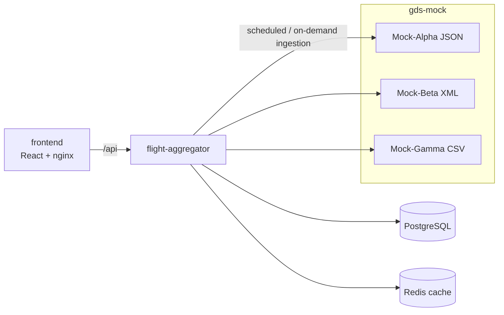

# Flight Aggregation & Cache Optimization System

An Online Travel Agency backend that ingests flight itineraries from three Global Distribution System (GDS)
providers — **Mock-Alpha** (JSON lists), **Mock-Beta** (nested XML) and **Mock-Gamma** (CSV streams) — and
deduplicates identical itineraries, keeping the cheapest offer plus a 5% OTA markup. It drops dead legs and invalid
connections and serves the result through a filterable, paginated search API and a dashboard.

Key constraints: 100,000 – 1,000,000 itinerary combinations per day, providers with 100 ms – 5000 ms latency and
random HTTP 500s (one failing provider must not break aggregation), a framework-free core domain, and a full stack
that boots with `docker compose up --build`.

Full statement: [docs/exercise.md](docs/exercise.md). Design write-up: **[SOLUTION.md](SOLUTION.md)**. Architecture:
**[docs/architecture/overview.md](docs/architecture/overview.md)**.

> **Status:** complete. All seven specs are implemented — the framework-free aggregation domain
> ([001](specs/001-itinerary-aggregation/spec.md)), the mock providers ([002](specs/002-gds-mock/spec.md)), resilient
> ingestion ([003](specs/003-provider-ingestion/spec.md)), PostgreSQL persistence with scheduled and on-demand runs
> ([004](specs/004-persistence-and-pipeline/spec.md)), the search API with keyset pagination and a Redis cache
> ([005](specs/005-search-api/spec.md)), the dashboard ([006](specs/006-dashboard/spec.md)) and the full-stack smoke
> test in CI ([007](specs/007-stack-smoke/spec.md)).

## Quick start

Requirements: Docker (with Compose v2). Nothing else is needed to run the stack.

```bash
docker compose up --build
```

What to expect, measured from a clean clone on a laptop (Apple M1 Max, 2026-11-07): after the base images are pulled
(PostgreSQL, Redis, JDK/JRE, Node, nginx — the only step that depends on your connection), the build takes **22 s**
(Maven and npm dependencies are downloaded inside the build), the five services are healthy **18 s** later, and the
first ingestion — scheduled 10 s after start-up, ≈ 94,500 itineraries from the three mock providers with their
latency and random errors — is `COMPLETED` **21 s** after that: **about a minute in all**. Then it runs every 15 min;
later starts reuse the images and the data (named volume).

The very first run also downloads the base images (Maven, Node, Temurin, nginx, PostgreSQL, Redis), which can add a
few minutes depending on the connection.

| URL | What |
|---|---|
| <http://localhost:3000> | **Dashboard** — search, filter, "Load more", data status, *Refresh data*, demo outage controls |
| <http://localhost:8080/swagger-ui.html> | API documentation (OpenAPI; committed copy: [docs/api/openapi.json](docs/api/openapi.json)) |
| <http://localhost:8080/api/v1/itineraries> | Search API (also through the dashboard's nginx at `localhost:3000/api/…`) |
| <http://localhost:8081/admin/providers> | gds-mock: the three providers' chaos settings and outage switches |


**Try it:** search from the dashboard (the filters live in the URL, so a search can be shared), page with "Load more",
watch the data status panel, press *Refresh data* to run an ingestion now, and in *Demo controls* take Mock-Beta down
and refresh again: the run ends `PARTIAL`, Beta `FAILED` with its breaker `OPEN`, the days keep their previous complete
data with `STALE` badges, and search keeps working ([docs/frontend.md](docs/frontend.md)). The same through the API:

```bash
curl http://localhost:8080/api/v1/ingestions/latest                              # the latest run, with its report
curl 'http://localhost:8080/api/v1/itineraries?origin=MAD&maxPrice=300&limit=5'  # cheapest first; follow nextCursor
curl http://localhost:8080/api/v1/catalog                                        # values for the filters
curl -X POST http://localhost:8080/api/v1/ingestions                             # start one now (409 if running)
docker compose down -v                                                           # stop and delete the data
```

Endpoints, configuration (volume, chaos, schedule, heap) and the 1M setup: [docs/usage.md](docs/usage.md).

## Components

| Component | Role | Decision |
|---|---|---|
| `frontend` | React + TypeScript dashboard served by nginx, which also proxies `/api` (same origin): search with URL state, keyset "Load more", live ingestion status with refresh, charts, demo outage controls | [ADR-0009](docs/adr/0009-react-frontend.md), [ADR-0023](docs/adr/0023-real-time-by-polling.md), [ADR-0024](docs/adr/0024-contract-generated-client-and-frontend-toolchain.md) |
| `flight-aggregator` | Scheduled + on-demand **ingestion** from the 3 providers in parallel with retries and circuit breakers, **deduplication** and pricing in a framework-free domain, day snapshots in PostgreSQL, **search API** with filters, keyset pagination and a catalog | [ADR-0006](docs/adr/0006-scheduled-pre-ingestion.md), [ADR-0010](docs/adr/0010-domain-assumptions.md), [ADR-0014](docs/adr/0014-provider-resilience.md) |
| `gds-mock` | Mock-Alpha (JSON), Mock-Beta (XML) and Mock-Gamma (CSV) over a seeded, streamed world of up to 1M itineraries, with latency, random errors and an outage switch | [ADR-0012](docs/adr/0012-single-gds-mock-application.md), [ADR-0013](docs/adr/0013-stateless-seeded-streamed-generation.md) |
| PostgreSQL | Source of truth: one row per itinerary, day snapshots, runs with their reports (Flyway, `COPY` bulk load, advisory run lock, search indexes) | [ADR-0007](docs/adr/0007-postgresql-and-redis.md), [ADR-0020](docs/adr/0020-search-indexes.md) |
| Redis | Search and catalog cache keyed by a data version that every ingestion write bumps; optional at runtime | [ADR-0022](docs/adr/0022-search-cache.md) |



Search reads only from PostgreSQL/Redis, never from the providers, and pages with keyset pagination
([ADR-0008](docs/adr/0008-keyset-pagination.md)). Containers, package dependencies, class diagrams per package and the
runtime flows: [docs/architecture/](docs/architecture/overview.md).

## Build and test

Requirements for development: JDK 21, Docker (Testcontainers), Node 26 for the frontend (`frontend/.nvmrc`); `jq` for
the smoke script and the Claude Code hooks; optionally the [GitHub CLI](https://cli.github.com/) and
[Claude Code](https://docs.claude.com/en/docs/claude-code/overview) for the AI-assisted workflow.

```bash
./mvnw verify                                   # both modules: format check, unit + integration tests, ArchUnit, coverage gate
./mvnw verify -Pslow-tests                      # also the 1,000,000-record volume tests (bulk load, search plans, keyset vs offset)
cd frontend && npm ci && npm run check          # frontend: Prettier, ESLint, tsc, Vitest with coverage gate
scripts/stack-smoke.sh                          # the whole stack end to end (below)
scripts/check-mermaid.sh                        # every Mermaid diagram in the docs renders
./mvnw -pl flight-aggregator spring-boot:run    # the aggregator alone (needs postgres, redis, gds-mock: see docs/usage.md)
```

### Full-stack smoke test

`scripts/stack-smoke.sh` checks the whole stack end to end, with the same script CI runs (job *Full stack smoke*,
[spec 007](specs/007-stack-smoke/spec.md)). It needs Docker, `curl`, `jq` and JDK 21:

```bash
scripts/stack-smoke.sh
```

It runs `docker compose build`, then `up --wait`, with [`docker-compose.ci.yml`](docker-compose.ci.yml) on top
(deterministic gds-mock, 20,000 itineraries, first ingestion after 2 s). Then, through the dashboard's nginx on port
3000, it:

1. waits for the first ingestion to finish `COMPLETED`;
2. checks that the catalog and two searches return data;
3. runs the e2e reconciliation test (`-Pe2e-tests`) against the running gds-mock;
4. forces a Mock-Beta outage and starts a run, which must finish `PARTIAL` with Beta `FAILED`, its breaker `OPEN`
   and search still answering;
5. recovers Beta.

On failure it prints `docker compose logs` (saved to `target/stack-smoke/compose.log`). It always ends with
`docker compose down -v`, also on Ctrl-C. It runs under its own compose project (`flight-aggregator-smoke`), so it
never deletes the volume of your own stack, but it needs ports 3000, 5432, 6379, 8080 and 8081 free: stop your
`docker compose up` stack first. With images already built it takes under a minute.
`STACK_SMOKE_BUILD_TIMEOUT` (default 600 s, applied when a `timeout` or `gtimeout` command exists),
`STACK_SMOKE_UP_TIMEOUT` (300 s for every service to become healthy, build excluded) and
`STACK_SMOKE_INGESTION_TIMEOUT` (180 s per run) change the waits.

## Quality gates

Applied to every Maven module, and the equivalent to the frontend.

| Gate | Tool | Where |
|---|---|---|
| Formatting | Spotless (palantir-java-format) | `verify`, pre-commit hook, Claude hook, CI |
| Unit tests (`*Test`) | JUnit 5, Mockito, AssertJ (Surefire) | `verify`, CI |
| Integration tests (`*IT`) | `@SpringBootTest` on a random port (Failsafe) | `verify`, CI |
| Architecture & SOLID rules | ArchUnit (`ArchitectureTest` per module) | `verify`, CI |
| Architecture docs | `ArchitectureDocsTest` (class-diagram types exist) in `verify`; `scripts/check-mermaid.sh` (diagrams render) | `verify`; the script in CI and on demand |
| Coverage ≥ 80 % lines / 70 % branches | JaCoCo (merged unit + IT, per module) | `verify`, CI (summary + PR comment) |
| Frontend: format, lint, types | Prettier, ESLint (`jsx-a11y`, `react-hooks`), `tsc` strict | `npm run check`, pre-commit (Prettier), Claude hooks, CI |
| Frontend: tests ≥ 80 % lines / 70 % branches | Vitest + React Testing Library + MSW | `npm run check`, pre-push, CI |
| Frontend: contract | types generated from `docs/api/openapi.json`, regenerated and diffed | CI |
| Frontend: image | `frontend/docker/smoke-test.sh` (headers, proxy scope, demo flag, non-root) | CI |
| Full stack | `scripts/stack-smoke.sh`: compose boot, ingestion, catalog and search through nginx, e2e reconciliation, provider outage | locally, CI |
| Vulnerable dependencies | Dependency Review, Dependabot (Maven, npm, Docker, Actions) | CI on PRs, weekly |
| Static security analysis | CodeQL (`security-and-quality`, Java and JavaScript/TypeScript) | CI on PRs, weekly |

Coverage report: `<module>/target/site/jacoco/index.html`.

## Development workflow (SDD)

1. **Spec** the feature in `specs/NNN-<slug>/spec.md` (Claude Code: `/spec-feature`).
2. Record significant **design decisions** as ADRs in `docs/adr/` (`/adr`).
3. **Implement** on a branch, tests first (`/implement-spec NNN`).
4. **Review** with the `code-reviewer` and `spec-reviewer` agents.
5. Open a **PR** with the What / Why / Changes format (`/pr-description`). CI must be green to merge.

`main` is protected: no direct commits or pushes (enforced by GitHub rulesets, git hooks and Claude Code hooks).
Everything in the repository is written in English (see [CLAUDE.md](CLAUDE.md)).

## Claude Code tooling

| Type | Name | Purpose |
|---|---|---|
| Skill | `spec-feature` | Requirement → spec with testable acceptance criteria |
| Skill | `implement-spec` | Spec → branch → tests → code → docs |
| Skill | `pr-description` | PR body in the required format + `gh pr create` |
| Skill | `adr` | Architecture Decision Record from the template |
| Agent | `code-reviewer` | SOLID / architecture / tests / security review of the branch |
| Agent | `spec-reviewer` | Acceptance-criteria traceability matrix, scope creep, spec drift |
| Agent | `test-engineer` | Writes tests and closes coverage gaps |
| Hook | `guard-git.sh` | Blocks commit/push on `main`, force-push and `--no-verify` |
| Hook | `format-java.sh` | Spotless after every Java/POM edit, scoped to the edited module |
| Hook | `format-frontend.sh` | Prettier after every edit under `frontend/` |
| Hook | `verify-on-stop.sh` | `./mvnw verify` and/or the frontend checks before Claude finishes, for whatever changed |
| Hook | `session-start.sh` | Activates `.githooks`, reports the current branch |

Project rules for Claude live in [CLAUDE.md](CLAUDE.md). The prompts and agents used to build the solution are
logged in [docs/ai/](docs/ai/README.md).

## Project structure

```
pom.xml               parent POM: shared plugin config (Spotless, JaCoCo, Failsafe), module list
mvnw                  Maven wrapper (run everything from the root)
flight-aggregator/    aggregation service (Spring Boot), base package com.andresps.flights
  src/main/java/com/andresps/flights/
    <feature>/domain           model and invariants (framework-free)
    <feature>/application      ports and use cases (framework-free)
    <feature>/infrastructure   adapters (REST, config, persistence...) and wiring
    shared/                    cross-feature building blocks
gds-mock/             mock GDS providers (Spring Boot), base package com.andresps.gdsmock
  src/main/java/com/andresps/gdsmock/
    inventory/                 seeded world generator, provider formats and feeds, expected figures
    chaos/                     latency, injected errors, outage switch
    shared/                    provider id, request errors, Problem Details handler
  Dockerfile                 multi-stage image (build context = repository root)
frontend/             dashboard (React + TypeScript + Vite), served by nginx; see docs/frontend.md
  src/api/                   generated API types + the fetch client
  src/hooks/, src/components/  state and presentation
  docker/                    nginx config, entrypoint (runtime config), image smoke test
docker-compose.yml    the whole stack (PostgreSQL, Redis, gds-mock, flight-aggregator, frontend)
docker-compose.ci.yml override for the full-stack smoke test (deterministic, small, fast)
scripts/              stack-smoke.sh (full-stack smoke test), check-mermaid.sh (diagrams render); locally and in CI
.claude/              shared Claude Code config: settings + hooks, skills, agents
.githooks/            versioned git hooks (pre-commit, pre-push)
.github/              CI, CodeQL, Dependabot, PR template
docs/                 exercise, usage, architecture (+ diagrams in docs/architecture/), ADRs, AI log, measurements,
                      provider formats, frontend, GitHub setup, OpenAPI (docs/api)
specs/                one spec per feature (SDD)
```

## Documentation

- [SOLUTION.md](SOLUTION.md) — executive summary, architectural decisions and AI tools, data modelling and pagination
  at 1M rows, limitations and trade-offs, what would change for production
- [Assessment statement](docs/exercise.md)
- **Architecture** — how to read it: [overview](docs/architecture/overview.md) (containers, package dependency rules)
  → [flows](docs/architecture/flows.md) (ingestion run, search request) → [package pages](docs/architecture/packages/README.md)
  (class diagrams); feature narrative and schema in [docs/architecture.md](docs/architecture.md)
- [Measurements at 1M rows](docs/measurements/search-1m.md) — indexes, query plans, keyset vs offset, cache latency
- [Provider formats](docs/providers.md) — Mock-Alpha JSON, Mock-Beta XML, Mock-Gamma CSV
- [Architecture Decision Records](docs/adr/README.md)
- [Specs](specs/README.md)
- [Usage](docs/usage.md)
- [Frontend](docs/frontend.md) — structure, data flow, how to run it, walkthrough for backend developers
- [API OpenAPI description](docs/api/openapi.json) (search and ingestion)
- [AI-assisted development log](docs/ai/README.md)
- [Repository bootstrap & GitHub setup](docs/github-setup.md)
