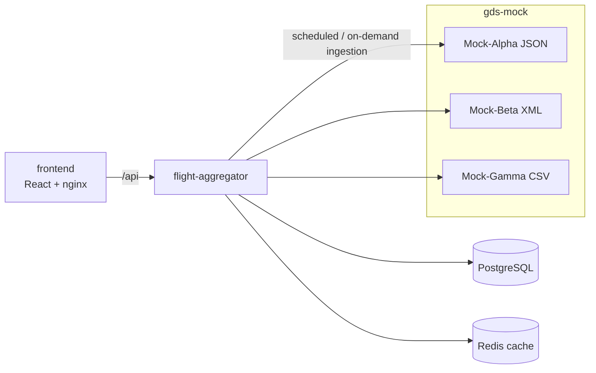

# Flight Aggregation & Cache Optimization System

An Online Travel Agency backend that ingests flight itineraries from three Global Distribution System (GDS)
providers — **Mock-Alpha** (JSON lists), **Mock-Beta** (nested XML) and **Mock-Gamma** (CSV streams) — and
deduplicates identical itineraries, keeping the cheapest offer plus a 5% OTA markup. It drops dead legs and invalid
connections and serves the result through a filterable, paginated search API and a dashboard.

Key constraints: 100,000 – 1,000,000 itinerary combinations per day, providers with 100 ms – 5000 ms latency and
random HTTP 500s (one failing provider must not break aggregation), a framework-free core domain, and a full stack
that boots with `docker compose up --build`.

Full statement: [docs/exercise.md](docs/exercise.md). Design write-up: [SOLUTION.md](SOLUTION.md).

> **Status:** core domain. The repository has the multi-module build, quality gates, agreed design decisions (ADRs)
> and the framework-free aggregation domain ([spec 001](specs/001-itinerary-aggregation/spec.md)): validation,
> deduplication and markup. Ingestion, search and the frontend land in their own PRs.

## Components

Target architecture. Each component is built in a later PR and described here once it exists.

| Component | Role | Decision |
|---|---|---|
| `gds-mock` | Mock-Alpha (JSON), Mock-Beta (XML) and Mock-Gamma (CSV) provider APIs over a seeded, streamed world of up to 1M itineraries, with latency, random errors and an outage switch (**implemented**) | [ADR-0012](docs/adr/0012-single-gds-mock-application.md), [ADR-0013](docs/adr/0013-stateless-seeded-streamed-generation.md) |
| `flight-aggregator` | Scheduled + on-demand **ingestion** from the 3 providers in parallel, **deduplication** and pricing in the domain, **search API** | [ADR-0006](docs/adr/0006-scheduled-pre-ingestion.md), [ADR-0010](docs/adr/0010-domain-assumptions.md) |
| PostgreSQL | Source of truth for itineraries and ingestion runs | [ADR-0007](docs/adr/0007-postgresql-and-redis.md) |
| Redis | Search results cache | [ADR-0007](docs/adr/0007-postgresql-and-redis.md) |
| `frontend` | React + TypeScript dashboard served by nginx | [ADR-0009](docs/adr/0009-react-frontend.md) |



Search reads only from PostgreSQL/Redis, never from the providers, and pages with keyset pagination
([ADR-0008](docs/adr/0008-keyset-pagination.md)).

## Requirements

- JDK 21
- Docker (for the planned compose stack and Testcontainers-based integration tests)
- Git, and optionally the [GitHub CLI](https://cli.github.com/) (`gh`)
- [Claude Code](https://docs.claude.com/en/docs/claude-code/overview) for the AI-assisted workflow
- `jq` or `python3` recommended (used by the Claude Code hooks to parse JSON)

## Quick start

**Current** — build and test all modules:

```bash
./mvnw verify                                   # format check, unit + IT tests, architecture rules, coverage gate
./mvnw -pl flight-aggregator spring-boot:run    # start the aggregator on http://localhost:8080
./mvnw verify -Pslow-tests                      # also the slow 1,000,000-record tests
```

`docker compose up --build` currently starts **gds-mock** only (port 8081, with a healthcheck). The rest of the stack
(aggregator, frontend, PostgreSQL, Redis) is added in later PRs.

See [docs/usage.md](docs/usage.md) for the endpoints that currently exist and their configuration.

## Quality gates

Applied to every Maven module.

| Gate | Tool | Where |
|---|---|---|
| Formatting | Spotless (palantir-java-format) | `verify`, pre-commit hook, Claude hook, CI |
| Unit tests (`*Test`) | JUnit 5, Mockito, AssertJ (Surefire) | `verify`, CI |
| Integration tests (`*IT`) | `@SpringBootTest` on a random port (Failsafe) | `verify`, CI |
| Architecture & SOLID rules | ArchUnit (`ArchitectureTest` per module) | `verify`, CI |
| Coverage ≥ 80 % lines / 70 % branches | JaCoCo (merged unit + IT, per module) | `verify`, CI (summary + PR comment) |
| Vulnerable dependencies | Dependency Review, Dependabot | CI on PRs, weekly |
| Static security analysis | CodeQL (`security-and-quality`) | CI on PRs, weekly |

Coverage report: `<module>/target/site/jacoco/index.html`.

## Development workflow (SDD)

1. **Spec** the feature in `specs/NNN-<slug>/spec.md` (Claude Code: `/spec-feature`).
2. Record significant **design decisions** as ADRs in `docs/adr/` (`/adr`).
3. **Implement** on a branch, tests first (`/implement-spec NNN`).
4. **Review** with the `code-reviewer` and `spec-reviewer` agents.
5. Open a **PR** with the What / Why / Changes format (`/pr-description`). CI must be green to merge.

`main` is protected: no direct commits or pushes (enforced by GitHub rulesets, git hooks and Claude Code hooks).
Everything in the repository is written in English (see [CLAUDE.md](CLAUDE.md)).

## Claude Code tooling

| Type | Name | Purpose |
|---|---|---|
| Skill | `spec-feature` | Requirement → spec with testable acceptance criteria |
| Skill | `implement-spec` | Spec → branch → tests → code → docs |
| Skill | `pr-description` | PR body in the required format + `gh pr create` |
| Skill | `adr` | Architecture Decision Record from the template |
| Agent | `code-reviewer` | SOLID / architecture / tests / security review of the branch |
| Agent | `spec-reviewer` | Acceptance-criteria traceability matrix, scope creep, spec drift |
| Agent | `test-engineer` | Writes tests and closes coverage gaps |
| Hook | `guard-git.sh` | Blocks commit/push on `main`, force-push and `--no-verify` |
| Hook | `format-java.sh` | Spotless after every Java/POM edit, scoped to the edited module |
| Hook | `verify-on-stop.sh` | `./mvnw verify` before Claude finishes, if any module changed |
| Hook | `session-start.sh` | Activates `.githooks`, reports the current branch |

Project rules for Claude live in [CLAUDE.md](CLAUDE.md). The prompts and agents used to build the solution are
logged in [docs/ai/](docs/ai/README.md).

## Project structure

```
pom.xml               parent POM: shared plugin config (Spotless, JaCoCo, Failsafe), module list
mvnw                  Maven wrapper (run everything from the root)
flight-aggregator/    aggregation service (Spring Boot), base package com.andresps.flights
  src/main/java/com/andresps/flights/
    <feature>/domain           model and invariants (framework-free)
    <feature>/application      ports and use cases (framework-free)
    <feature>/infrastructure   adapters (REST, config, persistence...) and wiring
    shared/                    cross-feature building blocks
gds-mock/             mock GDS providers (Spring Boot), base package com.andresps.gdsmock
  src/main/java/com/andresps/gdsmock/
    inventory/                 seeded world generator, provider formats and feeds, expected figures
    chaos/                     latency, injected errors, outage switch
    shared/                    provider id, request errors, Problem Details handler
  Dockerfile                 multi-stage image (build context = repository root)
docker-compose.yml    the stack (gds-mock for now)
.claude/              shared Claude Code config: settings + hooks, skills, agents
.githooks/            versioned git hooks (pre-commit, pre-push)
.github/              CI, CodeQL, Dependabot, PR template
docs/                 exercise, usage, architecture, ADRs, AI log, GitHub setup
specs/                one spec per feature (SDD)
```

## Documentation

- [SOLUTION.md](SOLUTION.md) — architectural decisions, data modelling and pagination, limitations
- [Assessment statement](docs/exercise.md)
- [Architecture](docs/architecture.md)
- [Architecture Decision Records](docs/adr/README.md)
- [Specs](specs/README.md)
- [Usage](docs/usage.md)
- [AI-assisted development log](docs/ai/README.md)
- [Repository bootstrap & GitHub setup](docs/github-setup.md)
