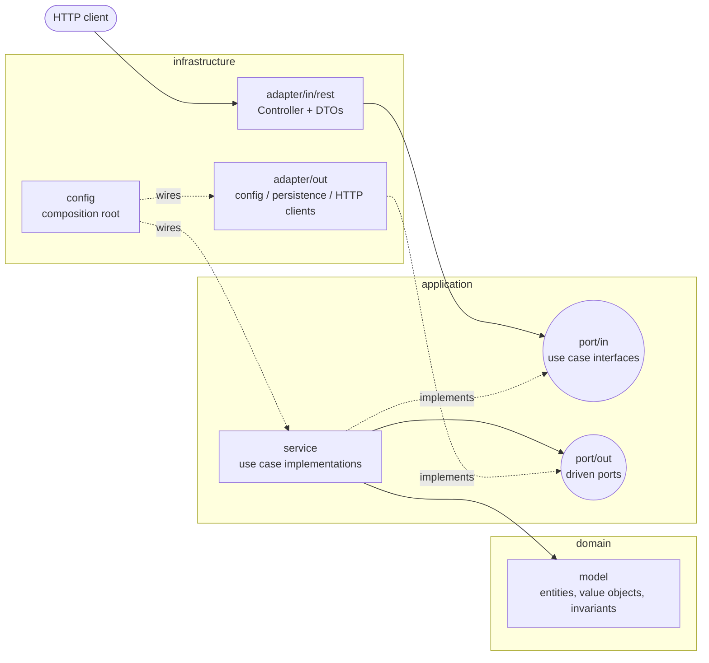
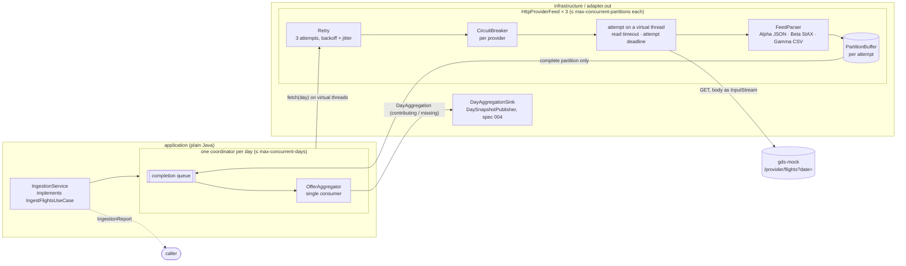
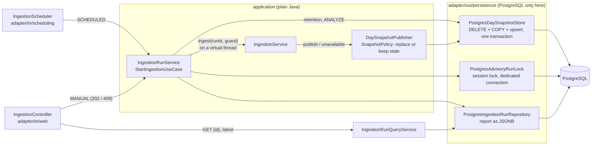
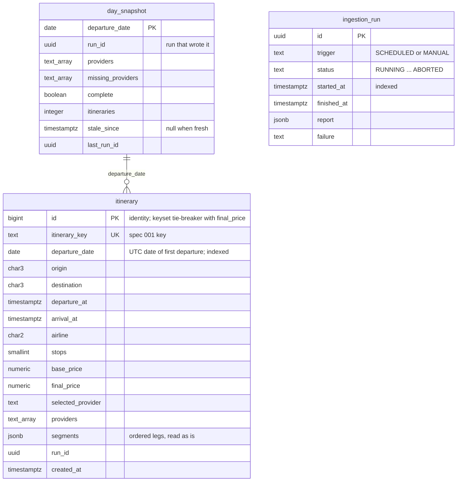
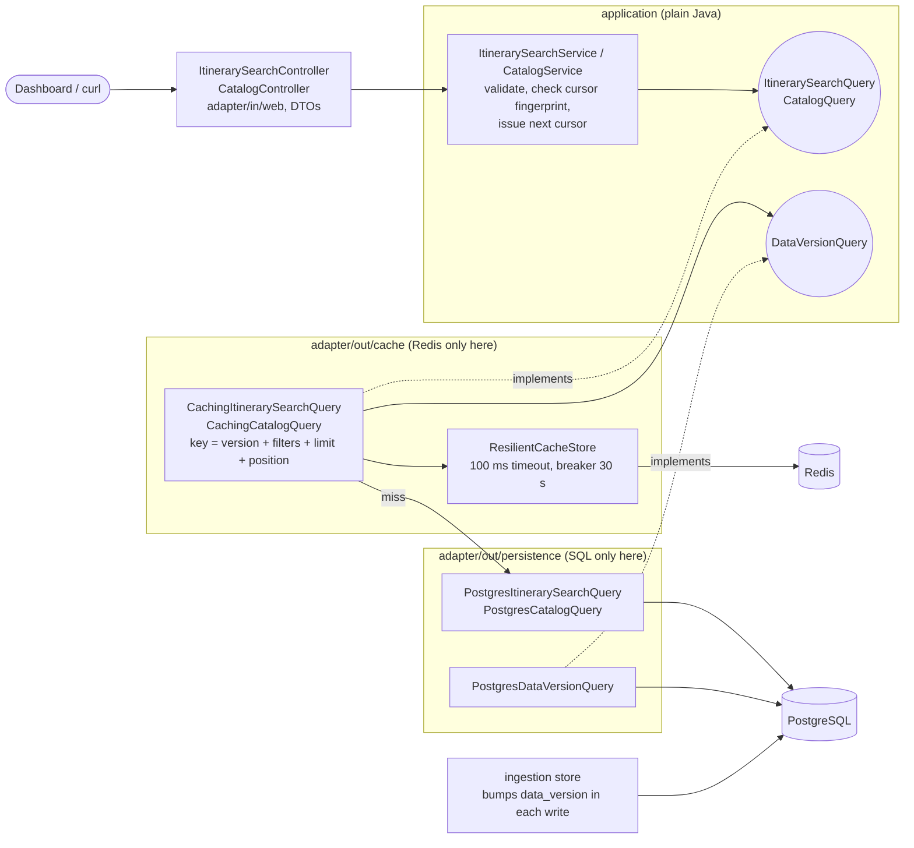

# Architecture

> Target system components (gds-mock, flight-aggregator, PostgreSQL, Redis, frontend) are summarised in the
> [README](../README.md#components) and decided in [ADR-0006](adr/0006-scheduled-pre-ingestion.md) to
> [ADR-0010](adr/0010-domain-assumptions.md). This page describes the internal structure every backend module follows.

Each backend module (`flight-aggregator`, `gds-mock`) follows **hexagonal architecture** (ports & adapters), organised **by feature** first and by layer
second. The rationale is in [ADR-0002](adr/0002-hexagonal-architecture.md).

`gds-mock` uses only `domain` and `infrastructure`. It has no use-case orchestration and no driven ports, so an
`application` layer would be single-implementation ceremony. Its `ArchitectureTest` keeps the domain framework-free,
keeps chaos out of the feeds, and forbids any dependency on the aggregator.

## Ingestion flow (spec 003)

The `ingestion` feature of `flight-aggregator` turns the three provider feeds into deduplicated itineraries, one
horizon day at a time ([ADR-0014](adr/0014-provider-resilience.md), [ADR-0015](adr/0015-atomic-partition-buffers.md),
[ADR-0016](adr/0016-day-partitioned-aggregation.md)).

1. A run reads "now" once, builds the horizon (the UTC days after today) and starts one coordinator per day, at most
   `max-concurrent-days` at a time. The run deadline cancels whatever is unfinished (`RUN_TIMEOUT`).
2. The coordinator asks each provider's feed for its day in parallel (`ProviderFeed`, an outbound port).
3. The feed makes an **attempt** on a virtual worker thread: the request, then the body streamed through the
   provider's parser into a fresh buffer. Malformed records are counted and skipped; a broken document fails the
   attempt. Attempts go through the provider's circuit breaker and are retried for provider failures only.
4. Only a completed attempt returns its partition (atomicity). The coordinator feeds each partition to the day's
   aggregator as soon as it arrives, then drops it.
5. When every partition of the day has finished, the day is handed to the sink (as *unavailable* if no provider
   contributed) and released. The day statistics are summed into the report.

## Persistence and the ingestion pipeline (spec 004)

Runs are triggered by the scheduler or `POST /api/v1/ingestions`, never overlap across instances, and write each day
as an atomic snapshot in PostgreSQL ([ADR-0017](adr/0017-day-snapshot-replacement.md),
[ADR-0018](adr/0018-bulk-load.md), [ADR-0019](adr/0019-ingestion-run-lock.md)).

A run, in order:

1. `pg_try_advisory_lock` on a connection kept for the whole run; if another instance holds it, a tick is skipped and
   `POST` answers `409` with the running id.
2. Any `RUNNING` row left by a dead process is marked `ABORTED`; the new run is stored `RUNNING` and `POST` returns.
3. On a virtual thread: delete days before today and runs older than 7 days; ingest (spec 003). Before each day is
   handed over, the lease checks that its session still holds the lock; if not, nothing more is published and the run
   ends `FAILED`.
4. Each day: the publisher drops itineraries departing on another UTC day (counted as misfiled), asks the
   `SnapshotPolicy`, and either replaces the day (delete its rows, `COPY` the new ones, upsert `day_snapshot`, one
   transaction) or keeps the stored snapshot and marks it stale. Readers see the old or the new day, never a mix.
5. `ANALYZE itinerary`, store the final status and report, release the lock.

### Schema

One denormalized row per itinerary: every search filter and the sort key are scalar columns of the same row, so a
search page is a single index range scan; segments are only displayed, so they travel as JSONB. Spec 005 adds the
search indexes `(final_price, id)` and `(origin, destination, final_price, id)` ([ADR-0020](adr/0020-search-indexes.md))
and the single-row `data_version` table that every writing transaction increments ([ADR-0022](adr/0022-search-cache.md)). `day_snapshot` and `itinerary` share `departure_date` but have no foreign key:
the day is written in one transaction anyway, and retention deletes both.

## Search (spec 005)

Search never calls providers: it reads the read model above, through a Redis cache that is invisible to the use case.

A search request:

1. The use case validates the filters (`400` naming the parameter), decodes the cursor and checks that its
   fingerprint matches the filters ([ADR-0021](adr/0021-search-cursor.md)).
2. The cache decorator reads the data version (one primary-key read) and looks the page up in Redis. On a hit it drops
   itineraries departed since the page was cached and keeps its next position; on a miss (or with Redis failing) it
   asks PostgreSQL and stores the page for 10 min.
3. PostgreSQL reads `limit + 1` rows `WHERE departure_at > now … AND (final_price, id) > cursor ORDER BY final_price,
   id`: one index range scan ([ADR-0008](adr/0008-keyset-pagination.md), [ADR-0020](adr/0020-search-indexes.md)),
   joined with the day's `day_snapshot` row for freshness.
4. The use case encodes the next cursor from the page's last position; the controller maps to DTOs.

The `search` and `ingestion` features have no Java dependency on each other (ArchUnit checks for cycles): they meet
only in the schema — ingestion writes `itinerary`, `day_snapshot` and `data_version`, search reads them.

An ingestion run that replaces a day or marks it stale increments `data_version` in the same transaction, so the next
request misses and reads the new data; old entries expire by TTL, nothing is deleted.

## Dependency rule

`infrastructure → application → domain`. Inner layers know nothing about outer ones, and `domain` and
`application` don't depend on Spring. This is verified on every build by
`ArchitectureTest` in each module (e.g. [`flight-aggregator`](../flight-aggregator/src/test/java/com/andresps/flights/architecture/ArchitectureTest.java)):

| Rule | Why |
|---|---|
| Domain doesn't depend on application/infrastructure | Business rules are independent of use cases and delivery |
| Domain and application are framework-free | Fast, plain unit tests; framework upgrades don't touch business code |
| Controllers live in `infrastructure.adapter.in` | Delivery mechanisms stay at the edge |
| PostgreSQL / JDBC only in `adapter.out.persistence` (and wiring); Redis only in `adapter.out.cache` (and wiring); the cache never touches SQL | Each technology has one home; the cache is a decorator of ports |
| No cycles between features | Features can evolve (or be extracted) independently |
| Constructor injection only, no generic exceptions, no `System.out` | Explicit dependencies, meaningful errors, proper logging |

## How SOLID maps to the code

- **S**ingle responsibility: one use case per inbound port; controllers only translate HTTP ↔ use case.
- **O**pen/closed: new behaviour comes as new adapters/use cases; existing ones are not modified to add variants.
- **L**iskov substitution: implementations honour the contract written in their interface's Javadoc (e.g. any
  `ItineraryRule` returns empty or one `DiscardReason` and never throws), so they are interchangeable and mockable.
- **I**nterface segregation: small, use-case-specific ports instead of broad "service" interfaces.
- **D**ependency inversion: the application owns its ports; infrastructure implements them and the composition root
  (`infrastructure/config`) wires concrete classes.

## Testing strategy

| Level | Naming | Scope | Tools |
|---|---|---|---|
| Unit | `*Test` | Domain, use cases, adapters in isolation (no Spring context) | JUnit 5, AssertJ, Mockito, standalone MockMvc |
| Integration | `*IT` | Full application on a random port, real HTTP; adapters against real servers | `@SpringBootTest`, `RestClient`, Testcontainers (one shared PostgreSQL and one shared Redis per build), WireMock |
| Volume (`slow` tag) | `*IT` | 1M rows: bulk load, query plans, keyset vs offset, cache latency | `-Pslow-tests` |
| Architecture | `ArchitectureTest` | Package dependencies and coding rules | ArchUnit |

Coverage from unit and integration tests is merged by JaCoCo per module; the build fails if any module drops below
80 % lines / 70 % branches.
