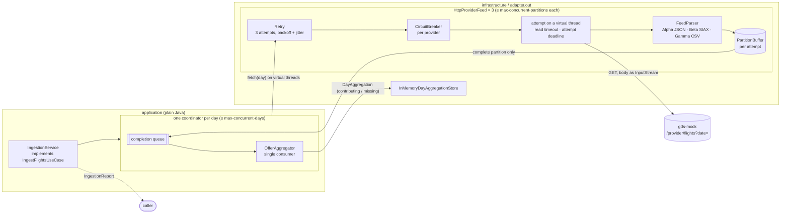

# Architecture

> Target system components (gds-mock, flight-aggregator, PostgreSQL, Redis, frontend) are summarised in the
> [README](../README.md#components) and decided in [ADR-0006](adr/0006-scheduled-pre-ingestion.md) to
> [ADR-0010](adr/0010-domain-assumptions.md). This page describes the internal structure every backend module follows.

Each backend module (`flight-aggregator`, `gds-mock`) follows **hexagonal architecture** (ports & adapters), organised **by feature** first and by layer
second. The rationale is in [ADR-0002](adr/0002-hexagonal-architecture.md).

`gds-mock` uses only `domain` and `infrastructure`. It has no use-case orchestration and no driven ports, so an
`application` layer would be single-implementation ceremony. Its `ArchitectureTest` keeps the domain framework-free,
keeps chaos out of the feeds, and forbids any dependency on the aggregator.

## Ingestion flow (spec 003)

The `ingestion` feature of `flight-aggregator` turns the three provider feeds into deduplicated itineraries, one
horizon day at a time ([ADR-0014](adr/0014-provider-resilience.md), [ADR-0015](adr/0015-atomic-partition-buffers.md),
[ADR-0016](adr/0016-day-partitioned-aggregation.md)).

1. A run reads "now" once, builds the horizon (the UTC days after today) and starts one coordinator per day, at most
   `max-concurrent-days` at a time. The run deadline cancels whatever is unfinished (`RUN_TIMEOUT`).
2. The coordinator asks each provider's feed for its day in parallel (`ProviderFeed`, an outbound port).
3. The feed makes an **attempt** on a virtual worker thread: the request, then the body streamed through the
   provider's parser into a fresh buffer. Malformed records are counted and skipped; a broken document fails the
   attempt. Attempts go through the provider's circuit breaker and are retried for provider failures only.
4. Only a completed attempt returns its partition (atomicity). The coordinator feeds each partition to the day's
   aggregator as soon as it arrives, then drops it.
5. When every partition of the day has finished, the day is published (if any provider contributed) and released.
   The day statistics are summed into the report.

## Dependency rule

`infrastructure → application → domain`. Inner layers know nothing about outer ones, and `domain` and
`application` don't depend on Spring. This is verified on every build by
`ArchitectureTest` in each module (e.g. [`flight-aggregator`](../flight-aggregator/src/test/java/com/andresps/flights/architecture/ArchitectureTest.java)):

| Rule | Why |
|---|---|
| Domain doesn't depend on application/infrastructure | Business rules are independent of use cases and delivery |
| Domain and application are framework-free | Fast, plain unit tests; framework upgrades don't touch business code |
| Controllers live in `infrastructure.adapter.in` | Delivery mechanisms stay at the edge |
| No cycles between features | Features can evolve (or be extracted) independently |
| Constructor injection only, no generic exceptions, no `System.out` | Explicit dependencies, meaningful errors, proper logging |

## How SOLID maps to the code

- **S**ingle responsibility: one use case per inbound port; controllers only translate HTTP ↔ use case.
- **O**pen/closed: new behaviour comes as new adapters/use cases; existing ones are not modified to add variants.
- **L**iskov substitution: implementations honour the contract written in their interface's Javadoc (e.g. any
  `ItineraryRule` returns empty or one `DiscardReason` and never throws), so they are interchangeable and mockable.
- **I**nterface segregation: small, use-case-specific ports instead of broad "service" interfaces.
- **D**ependency inversion: the application owns its ports; infrastructure implements them and the composition root
  (`infrastructure/config`) wires concrete classes.

## Testing strategy

| Level | Naming | Scope | Tools |
|---|---|---|---|
| Unit | `*Test` | Domain, use cases, adapters in isolation (no Spring context) | JUnit 5, AssertJ, Mockito, standalone MockMvc |
| Integration | `*IT` | Full application on a random port, real HTTP | `@SpringBootTest`, `RestClient` |
| Architecture | `ArchitectureTest` | Package dependencies and coding rules | ArchUnit |

Coverage from unit and integration tests is merged by JaCoCo per module; the build fails if any module drops below
80 % lines / 70 % branches.
