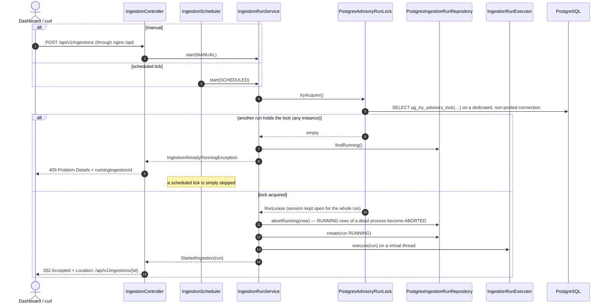
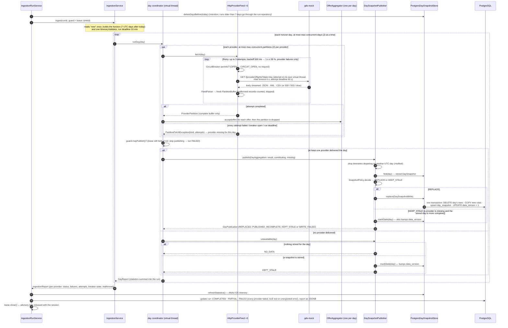
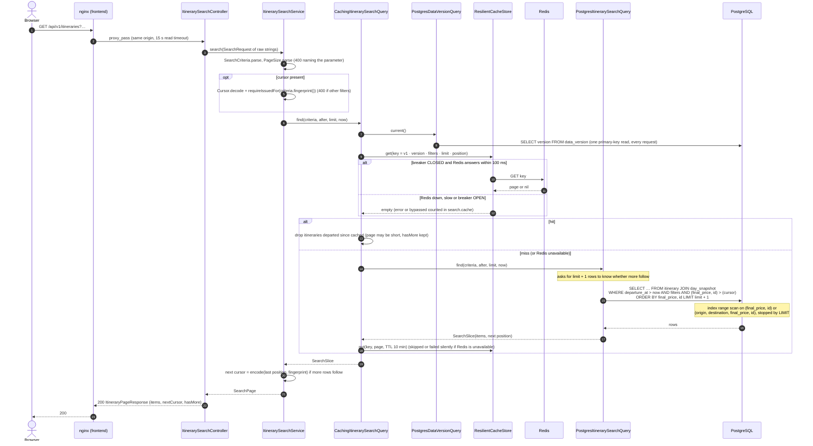

# Runtime flows

The two paths that matter at runtime, as sequence diagrams derived from the code on `main`. Participants are the
classes named in the [package pages](packages/README.md); the static structure is in [overview.md](overview.md).

## Ingestion run

Started by the scheduler (`SCHEDULED`, 10 s after startup, then 15 min after each run ends) or by
`POST /api/v1/ingestions` (`MANUAL`). Decisions: [ADR-0006](../adr/0006-scheduled-pre-ingestion.md) (schedule),
[ADR-0019](../adr/0019-ingestion-run-lock.md) (lock), [ADR-0014](../adr/0014-provider-resilience.md) (retries and
breakers), [ADR-0015](../adr/0015-atomic-partition-buffers.md) (atomic partitions),
[ADR-0016](../adr/0016-day-partitioned-aggregation.md) (one day at a time),
[ADR-0017](../adr/0017-day-snapshot-replacement.md) / [ADR-0018](../adr/0018-bulk-load.md) (day snapshots, `COPY`),
[ADR-0022](../adr/0022-search-cache.md) (data version).

### 1. Start: lock, orphan clean-up, `202`

### 2. Execute: parallel fetch, per-day aggregation, snapshot publish

**What a reader sees meanwhile.** Each day switches atomically from its old snapshot to the new one at its commit;
the `data_version` bump in the same transaction makes the next search miss the cache and read the new rows. The
dashboard polls `GET /api/v1/ingestions/latest` every 30 s (3 s while a run is `RUNNING`) and offers "New data
available" when a run published data ([ADR-0023](../adr/0023-real-time-by-polling.md)).

**One provider down** (the statement's resiliency case): its partitions fail fast once its breaker is `OPEN`, the
other two providers still deliver every day, each day is published with that provider *missing*, and
`SnapshotPolicy` keeps the previous, more complete snapshot (marked stale, at most 2 h) instead of dropping the
provider's offers. The run ends `PARTIAL`; search keeps answering. `scripts/stack-smoke.sh` checks exactly this in CI.

## Search request

`GET /api/v1/itineraries?origin=…&destination=…&date=…&maxPrice=…&carrier=…&limit=…&cursor=…` — search never calls the
providers. Decisions: [ADR-0008](../adr/0008-keyset-pagination.md) (keyset), [ADR-0020](../adr/0020-search-indexes.md)
(indexes), [ADR-0021](../adr/0021-search-cursor.md) (cursor), [ADR-0022](../adr/0022-search-cache.md) (cache).

**Redis down.** Every failed call counts against a Resilience4j breaker (window 10 calls, opens at 50 % failures
after at least 5 calls). Until it opens, a request can wait for two 100 ms timeouts (get and put); once open, Redis is
skipped for 30 s (`search.cache{result=bypassed}`), then probed again. Searches keep answering from PostgreSQL
throughout, and readiness does not depend on Redis. PostgreSQL itself must be up even for cache hits, because the
data version is read on every request.

**The catalog** (`GET /api/v1/catalog`) follows the same path through `CachingCatalogQuery`, with one addition: the
result is also memoised in the JVM per data version behind a lock, so a version bump or a Redis outage costs one
grouped scan (≈ 420 ms at 1M rows) instead of one per concurrent request.
