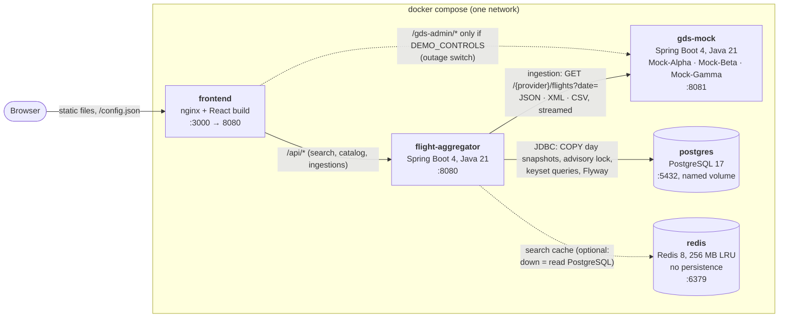
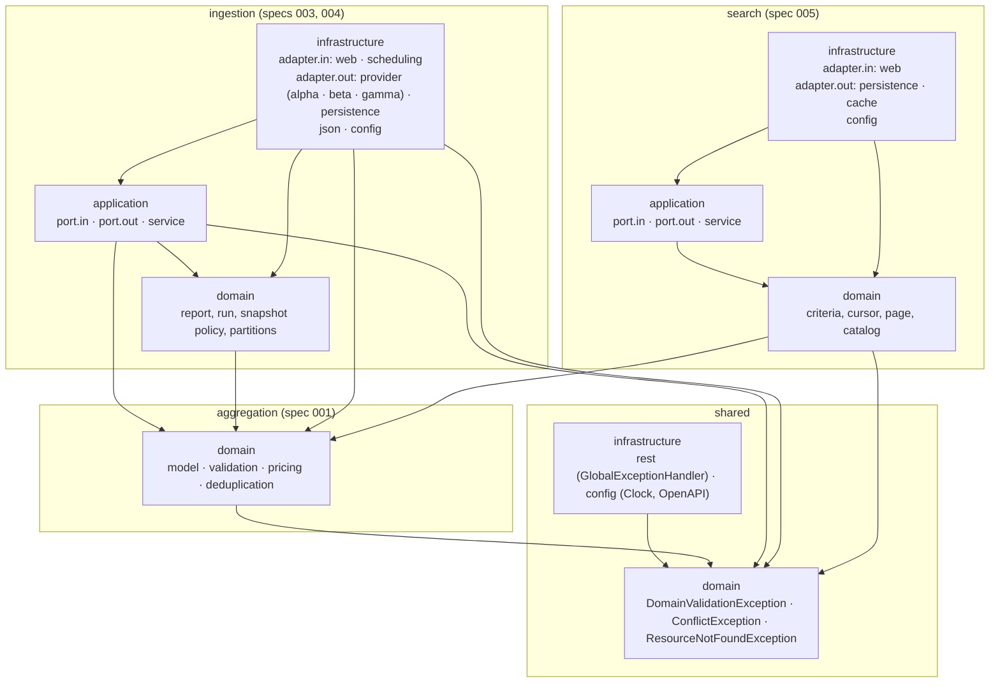
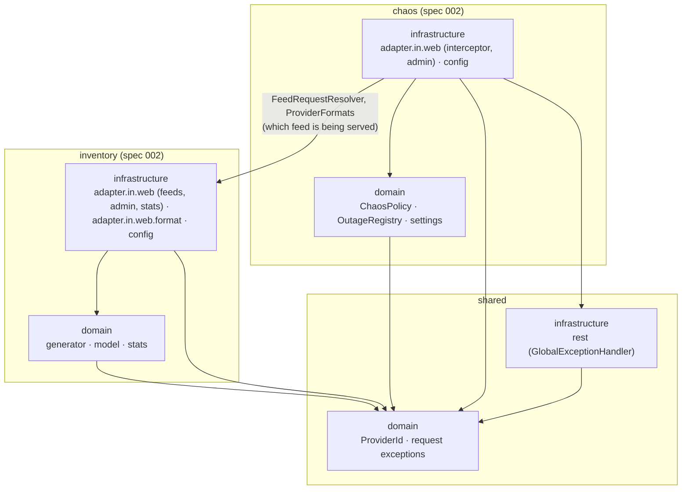

# Architecture overview

What runs, and how the code inside each backend module is organised. The diagrams are derived from the code on
`main` (`docker-compose.yml`, `frontend/docker/nginx.conf`, the Java packages and both `ArchitectureTest`s); the
reasons behind them are in the [ADRs](../adr/README.md). Per-package class diagrams: [packages/](packages/README.md); runtime
flows: [flows.md](flows.md).

## System view

Five containers, started by `docker compose up --build`. The browser talks only to nginx; search never calls the
providers, it reads what ingestion stored ([ADR-0006](../adr/0006-scheduled-pre-ingestion.md)).

| Container | Responsibility | Depends on (compose `depends_on: service_healthy`) | Decisions |
|---|---|---|---|
| `frontend` | Serves the dashboard and proxies `/api` to the aggregator on the same origin (no CORS); `/actuator` and Swagger UI are not proxied | `flight-aggregator` | [ADR-0009](../adr/0009-react-frontend.md), [ADR-0023](../adr/0023-real-time-by-polling.md) |
| `flight-aggregator` | Scheduled (every 15 min) and on-demand ingestion, deduplication and pricing, day snapshots in PostgreSQL, search API | `postgres`, `redis`, `gds-mock` | [ADR-0002](../adr/0002-hexagonal-architecture.md), [ADR-0006](../adr/0006-scheduled-pre-ingestion.md) |
| `gds-mock` | The three providers' legacy formats over a seeded world generated per request, with latency, random `500`s and an outage switch | — | [ADR-0012](../adr/0012-single-gds-mock-application.md), [ADR-0013](../adr/0013-stateless-seeded-streamed-generation.md) |
| `postgres` | Source of truth: itineraries (one row each), day snapshots, ingestion runs, data version | — | [ADR-0007](../adr/0007-postgresql-and-redis.md), [ADR-0017](../adr/0017-day-snapshot-replacement.md) |
| `redis` | Disposable search and catalog cache keyed by the data version | — | [ADR-0022](../adr/0022-search-cache.md) |

## Package layout and the dependency rule

Both backend modules are organised **by feature first, then by layer** ([ADR-0002](../adr/0002-hexagonal-architecture.md)).
Dependencies point inwards — `infrastructure → application → domain` — and `domain` and `application` are plain
Java. Each module's `ArchitectureTest` enforces this on every build, so the arrows below are the only directions the
build accepts. An arrow means "imports"; every arrow drawn exists in the code today.

### flight-aggregator (`com.andresps.flights`)

- **`aggregation`** is the core domain only (no ports, no adapters): the value objects, the validation rules, the
  markup and the incremental deduplication. `ingestion` drives it; `search` reuses its value objects
  (`AirportCode`, `AirlineCode`).
- **`ingestion` and `search` never import each other**: they meet only in the PostgreSQL schema (ingestion writes
  `itinerary`, `day_snapshot`, `data_version`; search reads them). The cycle rule would reject a dependency in both
  directions, and nothing needs one in either.
- **`shared`** holds the exceptions every feature maps to RFC 9457 Problem Details, the global handler and
  cross-cutting configuration.
- `ingestion.infrastructure.json` (the report's JSON mapping) sits outside `adapter`, because both the persistence
  adapter (report stored as JSONB) and the REST adapter (report served as is) use it.

Rules in [`ArchitectureTest`](../../flight-aggregator/src/test/java/com/andresps/flights/architecture/ArchitectureTest.java):

| Rule | Effect on the diagram |
|---|---|
| `domain` depends on no `application` / `infrastructure`; no Spring, Jakarta or Jackson | No arrow leaves a `domain` box except towards another `domain` |
| `application` depends on no `infrastructure` and no Spring | `application` only points at `domain` |
| HTTP (`java.net`), XML, JSON and Resilience4j only outside `domain` / `application` | Parsing, HTTP and resilience live in `adapter.out.provider` |
| PostgreSQL / Flyway only in `adapter.out.persistence`; JDBC only there and in `config` | One home per technology |
| Redis only in `adapter.out.cache` (and `config`); the cache uses no JDBC and no persistence adapter | The cache is a decorator of the query ports |
| Driven adapters (`adapter.out`) never use `application.service` or `application.port.in` | Adapters implement outbound ports only |
| `@RestController`s only in `infrastructure.adapter.in` | Delivery stays at the edge |
| Features (`aggregation`, `ingestion`, `search`, `shared`) are free of cycles | The arrows between features form a DAG |
| No field injection, generic exceptions, `java.util.logging` or `System.out`; `*Response` / `*Document` records never omit nulls | Coding rules, not drawn |

### gds-mock (`com.andresps.gdsmock`)

No `application` layer: the mock has no use-case orchestration and no driven ports, so ports would be
single-implementation ceremony ([ADR-0012](../adr/0012-single-gds-mock-application.md)). Its only adapters are
inbound (HTTP).

- **Chaos wraps the feeds, never the other way round**: `ChaosInterceptor` runs before the feed controllers and asks
  `inventory` which feed a request is for; `inventory` has no idea chaos exists.

Rules in [`ArchitectureTest`](../../gds-mock/src/test/java/com/andresps/gdsmock/architecture/ArchitectureTest.java):

| Rule | Effect on the diagram |
|---|---|
| Nothing depends on `com.andresps.flights` | The mock is a test double, not a client of the system it tests |
| `domain` depends on no `infrastructure`; generator and chaos policy are plain Java (no Spring, Jackson, XML) | No arrow leaves a `domain` box except towards `shared.domain` |
| Classes named `*Format` in `adapter.in.web.format` implement `ProviderFormat` | A new provider is a new format class |
| `inventory` never depends on `chaos` | The only arrow between the two features goes `chaos → inventory` |
| `@RestController`s only in `infrastructure.adapter.in`; features free of cycles; coding rules as above | — |

## How to read the architecture

1. **This page** — the containers and the allowed dependencies.
2. **[flows.md](flows.md)** — an ingestion run and a search request, step by step, including the Redis-down path.
3. **[packages/](packages/README.md)** — one page per feature and layer, with a class diagram of that package only and its
   interactions with other packages in text. Start with `ingestion` application, then follow the ports outwards.
4. **[ADRs](../adr/README.md)** for why, **[specs](../../specs/README.md)** for the acceptance criteria, and
   [SOLUTION.md](../../SOLUTION.md) for the measured results and trade-offs.

The type names in the class diagrams are checked against the code by a test, so a rename that is not reflected here
fails the build.
