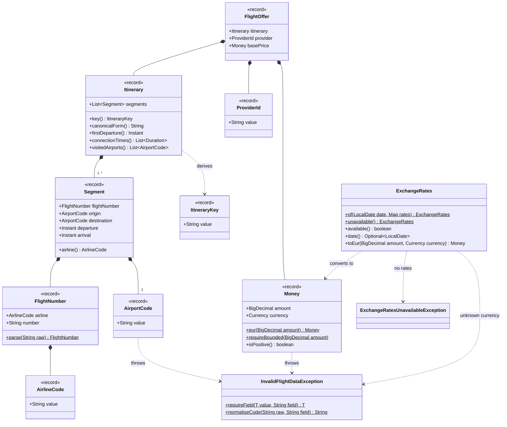

# aggregation · domain · model

`com.andresps.flights.aggregation.domain.model`

The value objects of the core domain (spec 001, [ADR-0010](../../../adr/0010-domain-assumptions.md)). Each record
validates its invariants in its constructor, so a malformed provider value (a 2-letter airport, a non-positive price,
an amount out of bounds) fails here, before it can reach the aggregator. `Money` is EUR only: `ExchangeRates` (spec 008,
[ADR-0025](../../../adr/0025-currency-normalisation-live-rates.md)) converts a provider amount in any currency to EUR
with the run's rates, before the offer is built. `Itinerary` derives the deduplication identity
(`ItineraryKey`: flight numbers, airports and departure instants) and the facts the validation rules need. Plain Java.

**Interactions with other packages**

- `InvalidFlightDataException` extends `DomainValidationException` (`shared.domain`), which the REST layer maps to
  `400`; during ingestion the provider adapters catch it and count the record as malformed.
- ← built by the provider parsers (`ingestion.infrastructure.adapter.out.provider`, through `RecordValues`), which
  convert every price with `ExchangeRates`; the rates come from the `ExchangeRateSource` port
  ([ingestion · application](ingestion-application.md)), once per run.
- ← consumed by [validation](aggregation-domain-validation.md) (`Itinerary`), [pricing](aggregation-domain-pricing-and-deduplication.md)
  (`Money`) and deduplication (`FlightOffer`, `ItineraryKey`, `ProviderId`).
- ← `search.domain` reuses `AirportCode` and `AirlineCode` to validate filters.
