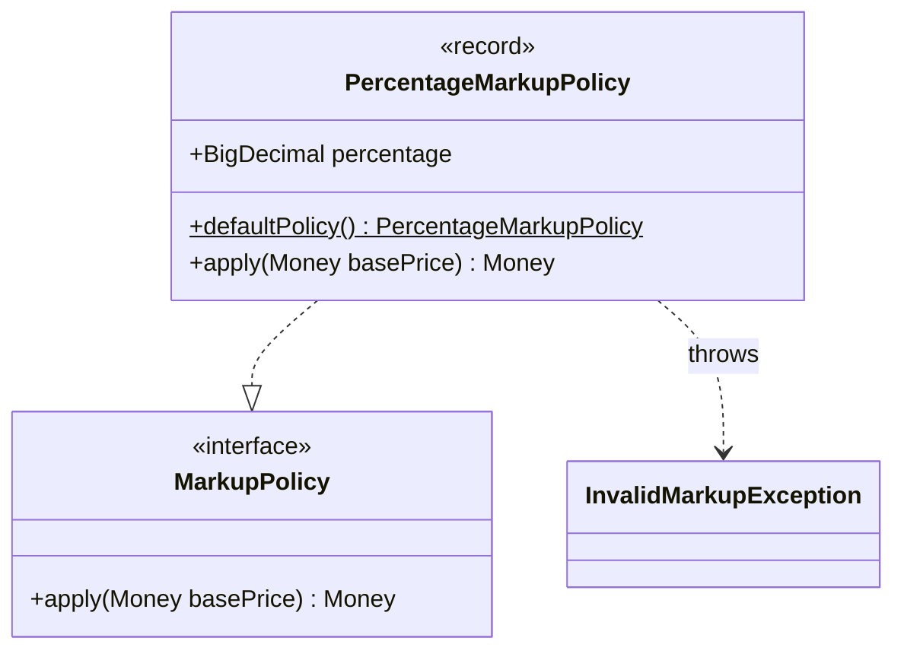
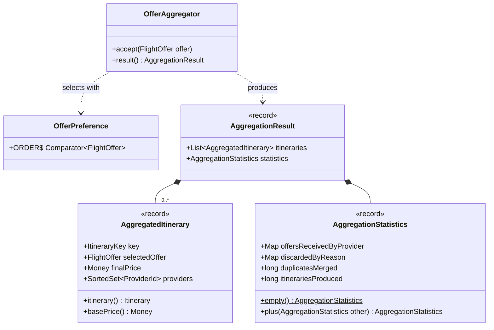

# aggregation · domain · pricing and deduplication

`com.andresps.flights.aggregation.domain.pricing`, `com.andresps.flights.aggregation.domain.deduplication`

The two decisions of the statement's aggregation rule. **Pricing** applies the OTA markup (5 % by default, rounded
`HALF_EVEN` once) behind the `MarkupPolicy` abstraction. **Deduplication** is incremental: `OfferAggregator` accepts
offers one at a time from the streaming parsers, keeps one candidate per `ItineraryKey` and replaces it only when
`OfferPreference` (lowest price → provider id → earliest arrivals → canonical form) prefers the newcomer, so the
winner never depends on arrival order ([ADR-0011](../../../adr/0011-incremental-deduplication.md)). Plain Java.

## pricing

## deduplication

**Interactions with other packages**

- `InvalidMarkupException` extends `DomainValidationException` (`shared.domain`).
- `OfferAggregator` → `ItineraryValidator` ([validation](aggregation-domain-validation.md)) for every offer (a
  discard is counted by `DiscardReason`), → `MarkupPolicy` for the winner's final price; it holds
  `FlightOffer`/`ItineraryKey`/`ProviderId` from [model](aggregation-domain-model.md).
- ← `IngestionService` (`ingestion.application.service`) runs one aggregator per horizon day, fed by a single consumer,
  and sums the days' `AggregationStatistics` with `plus` ([ADR-0016](../../../adr/0016-day-partitioned-aggregation.md)).
- ← `AggregatedItinerary` travels in `DayAggregation` (`ingestion.domain`) and `DaySnapshotWrite`
  (`ingestion.application.port.out`) to the PostgreSQL store, which writes one row per aggregated itinerary.
