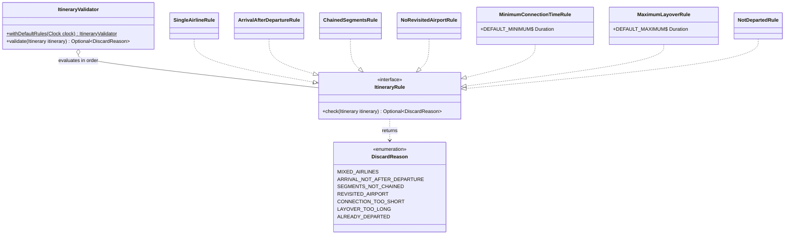

# aggregation · domain · validation

`com.andresps.flights.aggregation.domain.validation`

Filters out well-formed but unsellable itineraries: dead legs and invalid connections (spec 001). Each rule is one
class behind the one-method `ItineraryRule`; `ItineraryValidator` evaluates them in a fixed order and returns the
first violated rule's `DiscardReason`, so every discarded itinerary is counted under exactly one reason. A new rule is
a new class plus a `DiscardReason` constant. Plain Java; "now" comes from an injected `Clock`.

Default order (`withDefaultRules`): structural (single airline, arrival after departure, chained segments, no
revisited airport), then timing (connection ≥ 45 min, layover ≤ 24 h), then time-relative (not departed, against the
clock read once when the validator is built).

**Interactions with other packages**

- → reads `Itinerary` and its derived facts ([model](aggregation-domain-model.md)).
- ← `OfferAggregator` ([deduplication](aggregation-domain-pricing-and-deduplication.md)) calls `validate` for every
  offer; `DiscardReason` is the key of its discard statistics.
- ← `IngestionService` (`ingestion.application.service`) builds one validator per run with `withDefaultRules`.
