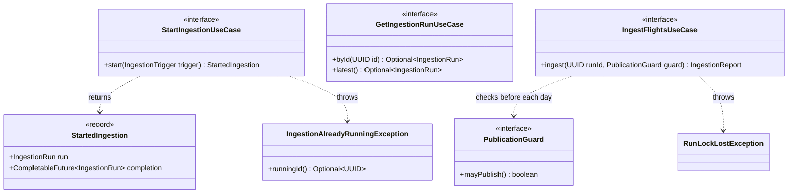
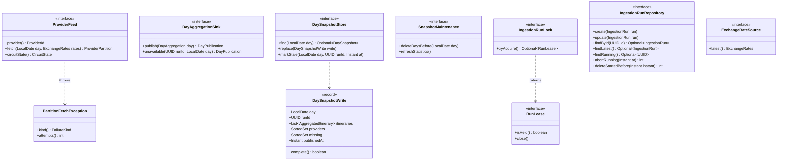
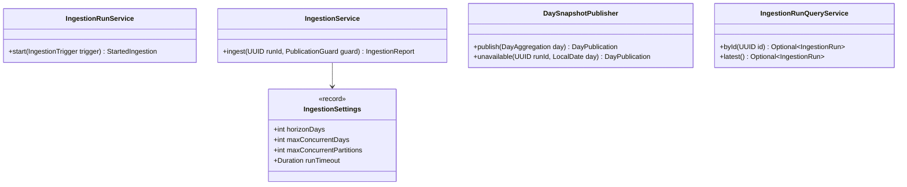

# ingestion · application

`com.andresps.flights.ingestion.application.port.in`, `….port.out`, `….service`

The ingestion use cases and the ports they own. **Driving ports** (`port.in`) are what the scheduler and the REST
controller call: start a run, read runs. **Driven ports** (`port.out`) are what the use cases need from the outside:
provider feeds, the day sink, the run lock, the run repository, the snapshot store. The **services** implement the
ports in plain Java, without Spring annotations; they are wired as beans in `ingestion.infrastructure.config`
([ADR-0002](../../../adr/0002-hexagonal-architecture.md)). Start here and follow the ports outwards.

## Driving ports (`port.in`)

## Driven ports (`port.out`)

## Use cases (`service`)

What each service implements and uses (ports from the diagrams above, not redrawn across packages):

| Service | Implements | Uses |
|---|---|---|
| `IngestionRunService` | `StartIngestionUseCase` | `IngestFlightsUseCase` (on an injected `Executor`), `IngestionRunLock`, `IngestionRunRepository`, `SnapshotMaintenance`, `Clock` |
| `IngestionService` | `IngestFlightsUseCase` | `ExchangeRateSource` (once per run; on failure `ExchangeRates.unavailable()`, spec 008), `ProviderFeed` × 3 (each fetch gets the run's rates), `DayAggregationSink`, `MarkupPolicy`, `Clock`, `IngestionSettings`; builds an `ItineraryValidator` and one `OfferAggregator` per day |
| `DaySnapshotPublisher` | `DayAggregationSink` | `DaySnapshotStore`, `SnapshotPolicy`, `Clock` |
| `IngestionRunQueryService` | `GetIngestionRunUseCase` | `IngestionRunRepository` |

**Interactions with other packages**

- ← `IngestionScheduler` and `IngestionController` ([adapters in](ingestion-infrastructure-in.md)) call
  `StartIngestionUseCase`; the controller also calls `GetIngestionRunUseCase`.
- → `ProviderFeed` is implemented by `HttpProviderFeed` and `ExchangeRateSource` by `FrankfurterExchangeRateSource`
  ([provider and FX adapters](ingestion-infrastructure-out-provider.md));
  `IngestionRunLock`, `IngestionRunRepository`, `DaySnapshotStore` and `SnapshotMaintenance` by the
  [PostgreSQL adapters](ingestion-infrastructure-out-persistence.md).
- → `aggregation.domain` (`OfferAggregator`, `ItineraryValidator`, `MarkupPolicy`) does the deduplication;
  `ingestion.domain` supplies the report, run and snapshot types and `SnapshotPolicy`.
- `IngestionAlreadyRunningException` extends `ConflictException` (`shared.domain`) → `409` with `runningIngestionId`.
- The runtime sequence is in [flows.md](../../flows.md#ingestion-run).
