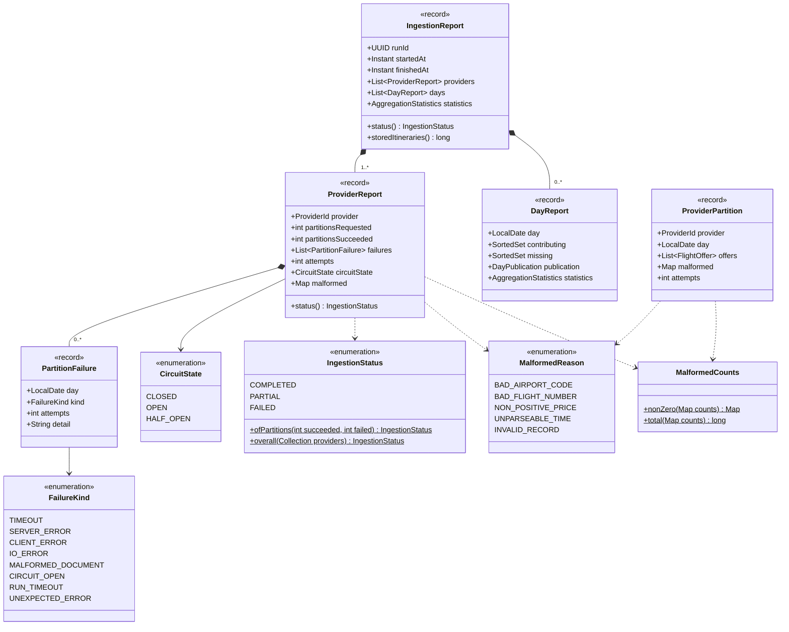
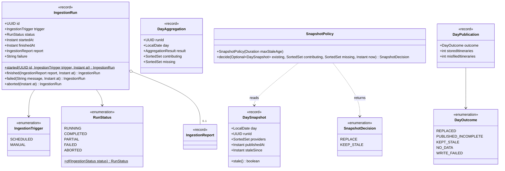

# ingestion · domain

`com.andresps.flights.ingestion.domain`

The vocabulary of an ingestion run (specs 003 and 004): what a provider delivered for one day (`ProviderPartition`),
how a run went (`IngestionReport` per provider and per day, statuses, failure kinds, malformed-record reasons), the
run's lifecycle (`IngestionRun`) and the rule that decides whether a day's new aggregation may replace the stored
snapshot (`SnapshotPolicy`, [ADR-0017](../../../adr/0017-day-snapshot-replacement.md)). Plain Java, no I/O. Split
into two diagrams: the report, and the run with its day snapshots.

## Report and partitions

## Run and day snapshots

`SnapshotPolicy.decide` replaces a day when no provider is missing, when nothing is stored yet, when the contributors
cover every provider of the stored snapshot, or when the stored snapshot has been stale for `max-stale-age` (2 h);
otherwise it keeps the stored snapshot and marks it stale. A run is `FAILED` only if every provider failed.

**Interactions with other packages**

- → `aggregation.domain`: partitions carry `FlightOffer`s, `DayAggregation` carries an `AggregationResult`, reports
  carry `AggregationStatistics`, and providers are `ProviderId`s.
- ← built and consumed by the use cases in [ingestion · application](ingestion-application.md): `IngestionService`
  assembles the report, `DaySnapshotPublisher` applies `SnapshotPolicy` and returns `DayPublication`s,
  `IngestionRunService` moves `IngestionRun` through its states.
- ← `ProviderPartition` is produced by `PartitionBuffer` in the provider adapters; `IngestionRun` / `IngestionReport`
  are stored by the persistence adapter and served by the REST adapter (both through `IngestionReportJson`).
