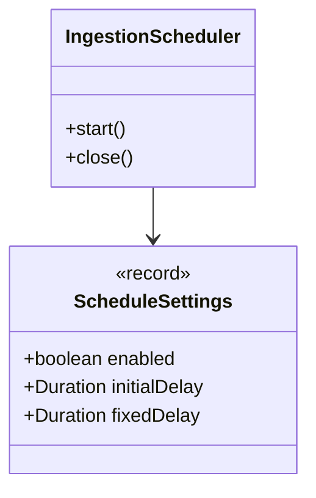
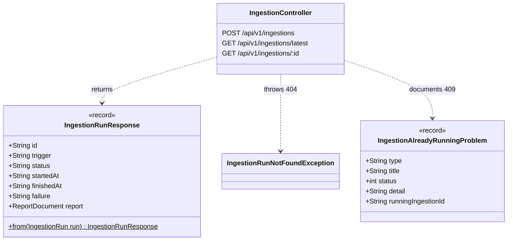

# ingestion · infrastructure · inbound adapters

`com.andresps.flights.ingestion.infrastructure.adapter.in.scheduling`, `….adapter.in.web`

The two ways a run starts ([ADR-0006](../../../adr/0006-scheduled-pre-ingestion.md)). The **scheduler** triggers a
`SCHEDULED` run 10 s after startup and then 15 min after each run ends, on Spring's `TaskScheduler`; it stops on
context close so shutdown never waits for a whole run. The **REST controller** exposes `POST /api/v1/ingestions`
(`202` + `Location`, `409` while a run is in progress), `GET /api/v1/ingestions/latest` and `GET /{id}`, and maps
domain runs to response records. Neither adapter contains logic beyond translation.

## scheduling

## web

`IngestionAlreadyRunningProblem` exists only to describe the `409` body in the OpenAPI document; the body itself is
written by `GlobalExceptionHandler` from `IngestionAlreadyRunningException`.

**Interactions with other packages**

- `IngestionScheduler` → `StartIngestionUseCase.start(SCHEDULED)`; an `IngestionAlreadyRunningException` (another
  instance holds the lock) skips the tick.
- `IngestionController` → `StartIngestionUseCase.start(MANUAL)` and `GetIngestionRunUseCase`
  ([ingestion · application](ingestion-application.md)).
- `IngestionRunResponse` embeds the report as `IngestionReportJson.ReportDocument`
  ([json](ingestion-infrastructure-out-persistence.md#json)), the same shape that is stored, so the API shows what is
  persisted.
- `IngestionRunNotFoundException` extends `ResourceNotFoundException` (`shared.domain`); errors become RFC 9457
  Problem Details in `shared.infrastructure.rest.GlobalExceptionHandler`.
- Both adapters are built in `ingestion.infrastructure.config.IngestionConfiguration`.
