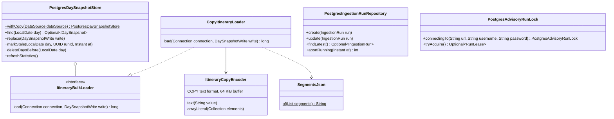
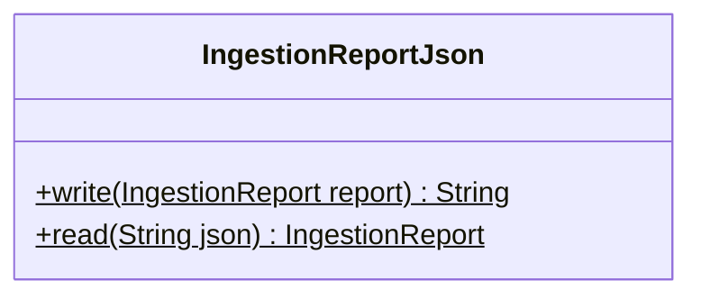
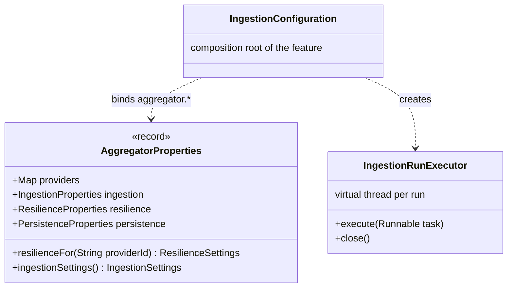

# ingestion · infrastructure · persistence, JSON and wiring

`com.andresps.flights.ingestion.infrastructure.adapter.out.persistence`, `….infrastructure.json`, `….infrastructure.config`

The PostgreSQL side of ingestion (spec 004) and the composition root of the feature. **Persistence** implements four
driven ports: each day is replaced in one transaction (delete its rows, bulk load the new ones with `COPY`, upsert
`day_snapshot`, bump `data_version`) ([ADR-0017](../../../adr/0017-day-snapshot-replacement.md),
[ADR-0018](../../../adr/0018-bulk-load.md)); runs are stored with their report as JSONB; the run lock is a session
advisory lock on a dedicated, non-pooled connection ([ADR-0019](../../../adr/0019-ingestion-run-lock.md)). It is the
only place with PostgreSQL-specific code (ArchUnit). **JSON** maps the report for both storage and the API.
**Config** builds every adapter and use case as a bean.

## persistence

| Adapter | Implements (`ingestion.application.port.out`) |
|---|---|
| `PostgresDaySnapshotStore` | `DaySnapshotStore`, `SnapshotMaintenance` (one adapter, two segregated ports) |
| `PostgresIngestionRunRepository` | `IngestionRunRepository` |
| `PostgresAdvisoryRunLock` | `IngestionRunLock`; its private lease implements `RunLease` |

`ItineraryBulkLoader` keeps the load technique replaceable: the batched-`INSERT` alternative lives in the tests, for
the benchmark that chose `COPY`.

## json

Its nested records (`ReportDocument`, `ProviderDocument`, `FailureDocument`, `DayDocument`, `StatisticsDocument`) are
the JSON shape of the report, stored in `ingestion_run.report` and embedded as is in `IngestionRunResponse`.

## config

**Interactions with other packages**

- ← the ports above are called by `IngestionRunService` and `DaySnapshotPublisher` ([ingestion · application](ingestion-application.md)).
- → PostgreSQL through `DataSource` / `JdbcClient`; `COPY` through PgJDBC's `PGCopyOutputStream`. Writes `itinerary`,
  `day_snapshot`, `ingestion_run` and `data_version`, which `search` reads ([schema](../../../architecture.md#schema)).
- `IngestionConfiguration` builds the three parsers, a breaker registry and one `HttpProviderFeed` per provider
  ([provider adapters](ingestion-infrastructure-out-provider.md)), the persistence adapters, the four use cases with
  a `PercentageMarkupPolicy` and `SnapshotPolicy`, the scheduler (started on `ApplicationReadyEvent`, stopped on
  `ContextClosedEvent`) and the controller's dependencies.
- `IngestionReportJson` ← used by `PostgresIngestionRunRepository` and by `IngestionRunResponse`
  ([adapters in](ingestion-infrastructure-in.md)).
