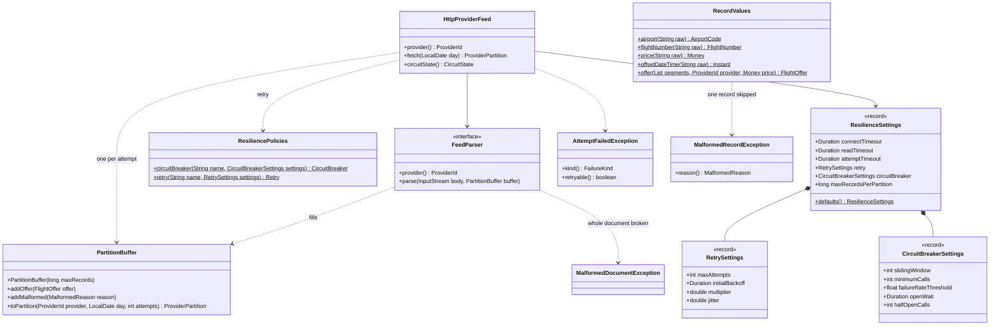
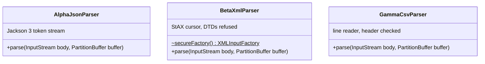

# ingestion · infrastructure · provider adapters

`com.andresps.flights.ingestion.infrastructure.adapter.out.provider` (+ `.alpha`, `.beta`, `.gamma`)

Implements the `ProviderFeed` port over HTTP, one `HttpProviderFeed` per provider (spec 003). An attempt is one request
plus the whole body streamed through the provider's `FeedParser` into a fresh `PartitionBuffer`, on its own virtual
thread, bounded by a read timeout and an attempt deadline; attempts go through the provider's Resilience4j circuit
breaker and are retried with backoff and jitter for provider failures only
([ADR-0014](../../../adr/0014-provider-resilience.md)). Only a completed attempt's buffer becomes a
`ProviderPartition` ([ADR-0015](../../../adr/0015-atomic-partition-buffers.md)). A new provider is a new `FeedParser`
plus a base URL.

## Feed, buffer and resilience

## Parsers

All three implement `FeedParser` (previous diagram) and build domain values through `RecordValues`. They read one
record at a time and never hold the document; hostile input is bounded (64 KiB per string, text or line, 16 legs or
segments per record, `max-records-per-partition` per attempt). Formats: [docs/providers.md](../../../providers.md).

**Interactions with other packages**

- `HttpProviderFeed` implements `ProviderFeed` (`ingestion.application.port.out`); ← called by `IngestionService` on
  virtual threads, at most `max-concurrent-partitions` per provider.
- → gds-mock over HTTP: `GET /{provider}/flights?date=` (see [gds-mock inventory adapters](../gds-mock/inventory-infrastructure.md)).
- → `aggregation.domain.model` value objects, built by `RecordValues`; a value-object exception (`InvalidFlightDataException`)
  becomes a `MalformedRecordException` with a `MalformedReason` (`ingestion.domain`).
- Failures leave as `PartitionFetchException` (`ingestion.application.port.out`) with a `FailureKind` and the attempt
  count, so the use case reports them without knowing about HTTP.
- Settings come from `AggregatorProperties` (`ingestion.infrastructure.config`), per provider with overrides.
