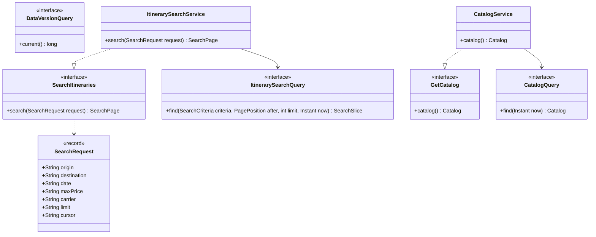

# search · application

`com.andresps.flights.search.application.port.in`, `….port.out`, `….service`

The two read use cases (spec 005). `ItinerarySearchService` parses and validates the raw request parameters (so the
use case owns every validation message), checks that a cursor was issued for the same filters, asks the query port
for `limit + 1` rows from the cursor's position and encodes the next cursor. `CatalogService` returns the filter
values. Both depend only on outbound ports; whether a result comes from Redis or PostgreSQL is invisible here,
because the cache is a decorator of the same ports ([ADR-0022](../../../adr/0022-search-cache.md)). Plain Java.

The three packages are drawn together because they are small (3 + 3 + 2 types): `port.in` holds `SearchItineraries`,
`GetCatalog`, `SearchRequest`; `port.out` holds the three queries; `service` the two implementations. Both services
also take a `Clock` ("now" for departed flights and default dates).

**Interactions with other packages**

- ← `ItinerarySearchController` and `CatalogController` (`search.infrastructure.adapter.in.web`) call the driving
  ports.
- → `ItinerarySearchQuery` and `CatalogQuery` are implemented twice in [search · infrastructure](search-infrastructure.md):
  by the PostgreSQL adapters and by the caching decorators that wrap them. `DataVersionQuery` is used only by the
  decorators and implemented by `PostgresDataVersionQuery`.
- → `search.domain` for criteria, cursor, page size and views.
