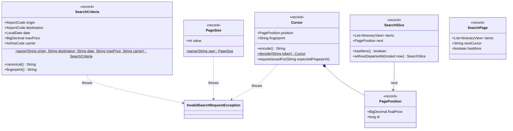
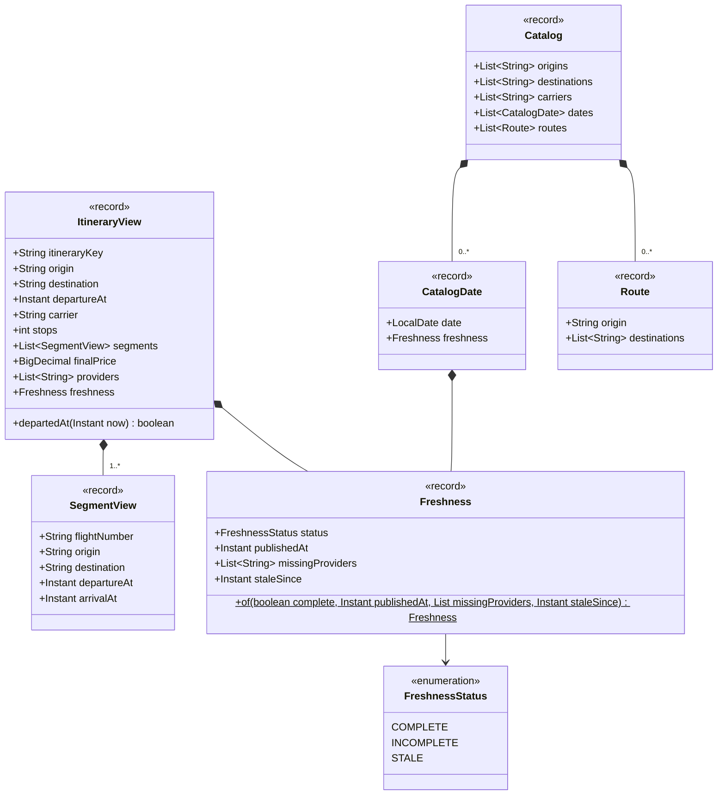

# search · domain

`com.andresps.flights.search.domain`

The read side's own model (spec 005): validated search criteria, the keyset position and the opaque cursor that
carries it, page sizes, and the views returned to clients (itineraries with their day's freshness, the catalog of
filter values). It is separate from the aggregation model on purpose: search reads denormalized rows and never
rebuilds `Itinerary` objects. `SearchCriteria.fingerprint()` ties a cursor to the filters that issued it
([ADR-0021](../../../adr/0021-search-cursor.md)). Plain Java. Two diagrams: criteria and paging, then views.

## Criteria, cursor and paging

`SearchSlice` is what a query port returns (items + the next keyset position); `SearchPage` is what the use case
returns (items + the encoded next cursor).

## Views and catalog

**Interactions with other packages**

- → `aggregation.domain.model`: `AirportCode` and `AirlineCode` validate the filter codes.
- `InvalidSearchRequestException` extends `DomainValidationException` (`shared.domain`) → `400` naming the parameter.
- ← used by the use cases and ports of [search · application](search-application.md); rows are mapped into these
  views by `ReadModelRows` and cached by `SearchCacheCodec` ([search · infrastructure](search-infrastructure.md)).
- No dependency on `ingestion`: the two features share only the PostgreSQL schema.
