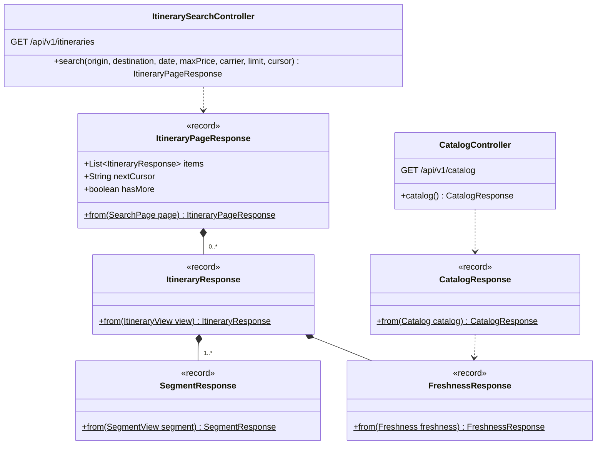
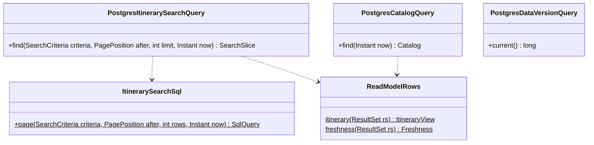
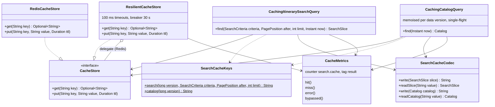
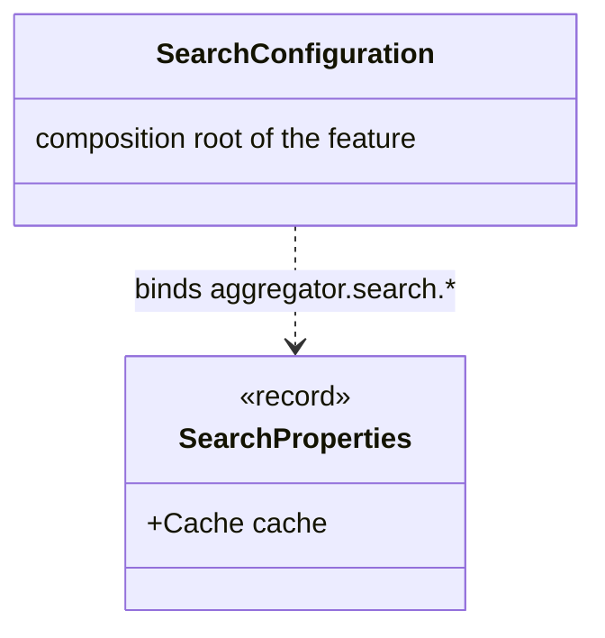

# search · infrastructure

`com.andresps.flights.search.infrastructure.adapter.in.web`, `….adapter.out.persistence`, `….adapter.out.cache`, `….config`

Everything technical about search (spec 005). **web** exposes `GET /api/v1/itineraries` and `GET /api/v1/catalog` and
maps domain views to `*Response` records (documented in OpenAPI). **persistence** builds the keyset SQL — `limit + 1`
rows `WHERE (final_price, id) > cursor ORDER BY final_price, id`, served by the two search indexes
([ADR-0008](../../../adr/0008-keyset-pagination.md), [ADR-0020](../../../adr/0020-search-indexes.md)). **cache**
decorates the two query ports with Redis cache-aside keyed by the data version, and degrades to PostgreSQL when Redis
is slow or down ([ADR-0022](../../../adr/0022-search-cache.md)). Redis code lives only in `cache`, SQL only in
`persistence` (ArchUnit).

## web

## persistence

Codes are compared as `bpchar` placeholders so the `char(n)` columns are not cast and the indexes stay usable.

## cache

At runtime the chain is `CachingItinerarySearchQuery → ResilientCacheStore → RedisCacheStore`, and on a miss
`→ PostgresItinerarySearchQuery`. A hit drops itineraries that departed since the page was cached.

## config

**Interactions with other packages**

- Controllers → `SearchItineraries` / `GetCatalog` ([search · application](search-application.md)); errors →
  `shared.infrastructure.rest.GlobalExceptionHandler`.
- `PostgresItinerarySearchQuery` and `CachingItinerarySearchQuery` implement `ItinerarySearchQuery`;
  `PostgresCatalogQuery` and `CachingCatalogQuery` implement `CatalogQuery`; `PostgresDataVersionQuery` implements
  `DataVersionQuery` (`search.application.port.out`). The decorators hold the PostgreSQL adapter only as the port
  (ArchUnit forbids the cache from touching `persistence` or JDBC).
- `SearchConfiguration` wires `Caching* → Postgres*` when `aggregator.search.cache.enabled` (default), the bare
  PostgreSQL adapters otherwise, and registers `CacheMetrics` on Micrometer's `MeterRegistry`.
- → PostgreSQL reads `itinerary` joined with `day_snapshot`, and `data_version`, all written by `ingestion`.
- The runtime sequence, including Redis down, is in [flows.md](../../flows.md#search-request).
