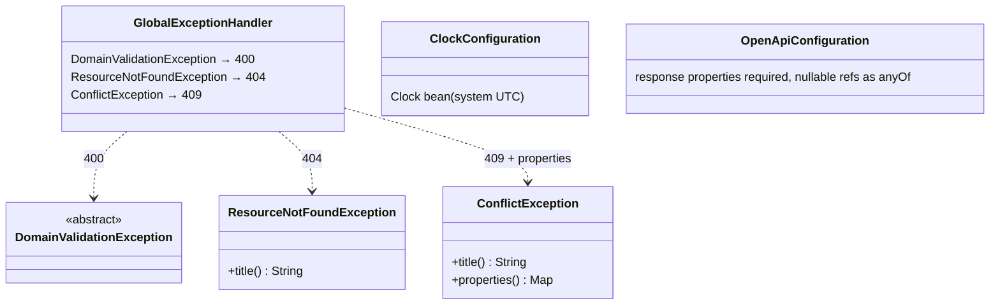

# shared

`com.andresps.flights.shared.domain`, `….shared.infrastructure.rest`, `….shared.infrastructure.config`

Cross-feature building blocks of the aggregator. **domain** defines the three exception families every feature maps
its errors onto, so the web layer can translate them without knowing any feature. **rest** is the single
`@RestControllerAdvice` that turns them into RFC 9457 Problem Details. **config** provides the `Clock` bean every
feature injects (tests replace it) and the OpenAPI customizer that keeps `docs/api/openapi.json` exact.

**Interactions with other packages**

- ← `DomainValidationException` is extended by `InvalidFlightDataException`, `InvalidMarkupException`
  (`aggregation.domain`) and `InvalidSearchRequestException` (`search.domain`).
- ← `ResourceNotFoundException` by `IngestionRunNotFoundException`; `ConflictException` by
  `IngestionAlreadyRunningException` (whose `properties()` add `runningIngestionId` to the `409`).
- ← `Clock` injected into the use cases of `ingestion` and `search`; `OpenApiConfiguration` post-processes the
  springdoc document that `OpenApiContractIT` compares with `docs/api/openapi.json`.
- Depends on no feature package (only `shared.infrastructure → shared.domain`).
