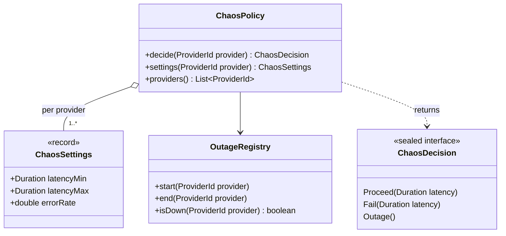
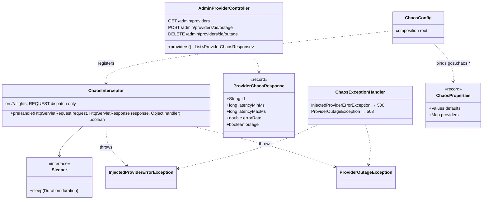

# gds-mock · chaos

`com.andresps.gdsmock.chaos.domain`, `….chaos.infrastructure.adapter.in.web`, `….chaos.infrastructure.config`

The statement's unreliable providers (spec 002): latency between 100 ms and 5000 ms, random `500`s (10 % by default)
and an outage switch per provider (`503`). `ChaosPolicy` decides, in plain Java with injected randomness;
`ChaosInterceptor` applies the decision before the feed controller runs — sleeping, then letting the request through
or throwing — so serializers and controllers know nothing about chaos. The admin API toggles outages at runtime; the
dashboard's demo controls reach it through nginx `/gds-admin/`.

## domain

## web and config

The interceptor ignores `ASYNC` dispatches: a streamed feed is dispatched again when its body completes, and applying
chaos twice doubled the latency and could fail a feed already sent (found by `ConcurrencyIT`).

**Interactions with other packages**

- `ChaosInterceptor` → `ChaosPolicy` (domain) and `FeedRequestResolver`
  ([inventory · infrastructure](inventory-infrastructure.md)); `AdminProviderController` → `ChaosPolicy`,
  `OutageRegistry`.
- `ChaosConfig` → `ProviderFormats` (inventory) for the provider ids; `Sleeper` is `Thread::sleep` in production and
  replaced in tests, so chaos is tested without sleeping.
- `ChaosExceptionHandler` builds its Problem Details with `GlobalExceptionHandler.problem`
  ([shared](shared.md)); → `ProviderId` and `UnknownProviderException` from `gdsmock.shared.domain`.
- ← the aggregator sees only the effect: slow answers, `500`s and `503`s, which its retries and circuit breakers
  absorb.
