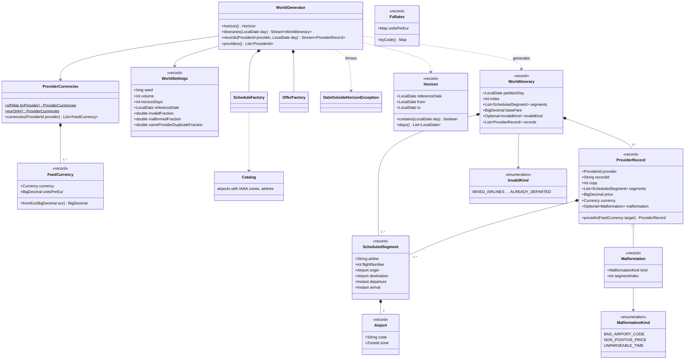
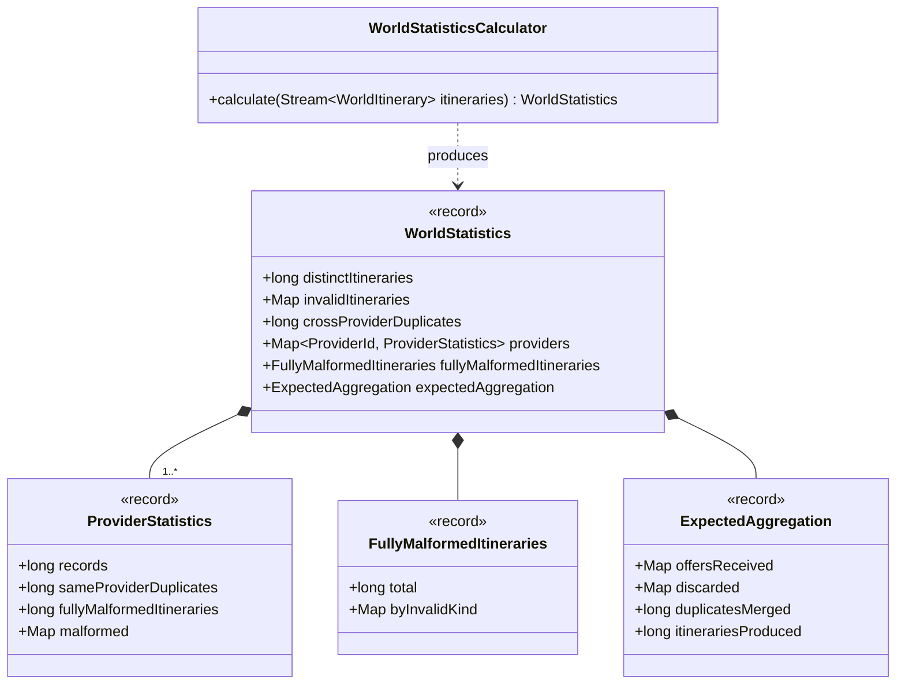

# gds-mock · inventory · domain

`com.andresps.gdsmock.inventory.domain.generator`, `….domain.model`, `….domain.stats`

The mock's world (spec 002, [ADR-0013](../../../adr/0013-stateless-seeded-streamed-generation.md)). `WorldGenerator`
produces itinerary *i* of day *d* from its own seeded `SplittableRandom`, lazily and on demand, so a provider or a day
is generated on its own, every provider sees the same itinerary, and nothing is ever materialised. Each world
itinerary carries the provider records that offer it — cross- and same-provider duplicates at different prices, one
invalid kind per spec 001 discard reason, malformed records. `WorldStatisticsCalculator` reports what the world
contains and what the aggregator should produce from it, for exact reconciliation. Spec 008: `ProviderCurrencies`
prices each record in a currency drawn from its provider's list (`FeedCurrency`: code + units per EUR) with a seed of
its own, derived from the itinerary's seed, the provider and the copy, so the world never changes with the currencies.
Plain Java.

## generator and model

`InvalidKind` mirrors the aggregator's seven `DiscardReason`s by name (the two modules share no code).

## stats

**Interactions with other packages**

- → `gdsmock.shared.domain`: `ProviderId`; `DateOutsideHorizonException` extends `InvalidRequestException` (→ `400`).
- ← `ProviderFeedController` streams `records(provider, day)` through a `ProviderFormat`, and `WorldStatsController`
  serves `WorldStatisticsCalculator`'s result through `WorldStatisticsCache`
  ([inventory · infrastructure](inventory-infrastructure.md)).
- ← The aggregator's e2e test (`IngestionReconciliationE2EIT`) compares its ingestion report with these statistics over
  HTTP; there is no code dependency.
