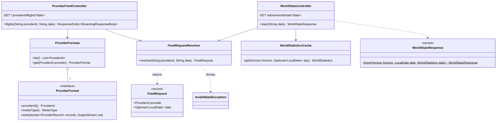
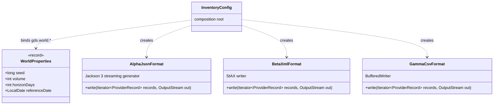

# gds-mock · inventory · infrastructure

`com.andresps.gdsmock.inventory.infrastructure.adapter.in.web`, `….adapter.in.web.format`, `….config`

The HTTP face of the mock providers (spec 002, [ADR-0012](../../../adr/0012-single-gds-mock-application.md)).
`GET /{provider}/flights?date=` resolves the provider and day, then streams the generator's records straight into the
response through that provider's `ProviderFormat` — Mock-Alpha a JSON list, Mock-Beta nested XML, Mock-Gamma CSV — so
a 1M feed never sits in memory. `GET /admin/world/stats` reports the reconciliation figures, cached per horizon and
day. A new provider is a new `ProviderFormat` bean (ArchUnit checks every `*Format` implements it). Formats:
[docs/providers.md](../../../providers.md).

## web

## format and config

The three formats implement `ProviderFormat` (previous diagram). A shared contract test runs the same round-trip,
empty-feed, streaming and client-disconnect checks against each.

**Interactions with other packages**

- → `WorldGenerator`, `WorldStatisticsCalculator` and the model records ([inventory · domain](inventory-domain.md)).
- → `gdsmock.shared.domain`: `ProviderId`; `InvalidDateException` extends `InvalidRequestException` (→ `400`), an
  unknown provider is `UnknownProviderException` (→ `404`).
- ← `ChaosInterceptor` ([chaos](chaos.md)) runs before `ProviderFeedController` and uses `FeedRequestResolver` to know
  which provider a request is for; `ChaosConfig` uses `ProviderFormats` for the provider ids. Inventory never depends
  on chaos.
- ← called by the aggregator's `HttpProviderFeed` (one request per provider and day) and by its e2e test (stats).
