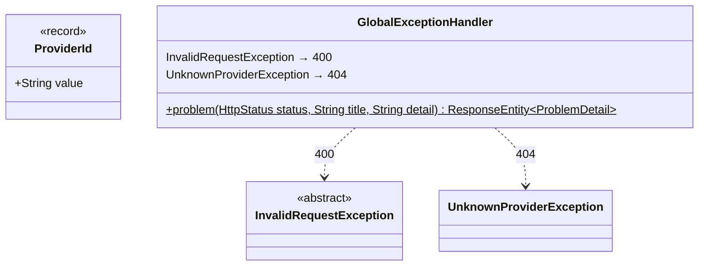

# gds-mock · shared

`com.andresps.gdsmock.shared.domain`, `com.andresps.gdsmock.shared.infrastructure.rest`

Building blocks used by both gds-mock features. `ProviderId` names a provider (`mock-alpha`, `mock-beta`,
`mock-gamma`); the request exceptions are what the features throw for bad input, and `GlobalExceptionHandler` turns
them into RFC 9457 Problem Details. It is gds-mock's own copy of these ideas: the module shares no code with the
aggregator (ArchUnit).

**Interactions with other packages**

- ← `InvalidRequestException` is extended by `DateOutsideHorizonException` (`inventory.domain.generator`) and
  `InvalidDateException` (`inventory.infrastructure.adapter.in.web`).
- ← `ProviderId` is used throughout `inventory` and `chaos`; `GlobalExceptionHandler.problem` is reused by
  `ChaosExceptionHandler` ([chaos](chaos.md)).
- There is no catch-all handler: unexpected errors use Spring Boot's default response (see SOLUTION.md, limitations).
