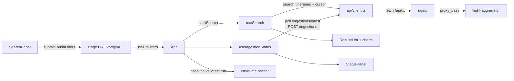

# Frontend (dashboard)

The dashboard required by the statement — *"search, filter, and visualize these itineraries in real-time"* — is a
small React + TypeScript single-page app in [`frontend/`](../frontend), built with Vite and served by nginx
([spec 006](../specs/006-dashboard/spec.md), [ADR-0009](adr/0009-react-frontend.md),
[ADR-0023](adr/0023-real-time-by-polling.md), [ADR-0024](adr/0024-contract-generated-client-and-frontend-toolchain.md)).
This page is written for a backend developer: it maps each frontend idea to something familiar.


## Run it

| How | Command | URL |
|---|---|---|
| Whole stack | `docker compose up --build` | <http://localhost:3000> |
| Dev server (hot reload) against a running backend | `cd frontend && npm ci && npm run dev` | <http://localhost:5173> |
| Checks (what CI runs) | `cd frontend && npm run check` | — |
| Production build | `cd frontend && npm run build` (output in `dist/`) | — |
| Image smoke test | `bash frontend/docker/smoke-test.sh` | — |
| Layout check in Chromium (after a build; once: `npx playwright install chromium`) | `cd frontend && npm run test:layout` | — |

The dev server proxies `/api` to `localhost:8080` and `/gds-admin` to `localhost:8081/admin` (see
`vite.config.ts`), exactly like nginx does in the container, so the browser always talks to one origin and no CORS is
needed. Start the backend first, e.g. `docker compose up -d postgres redis gds-mock flight-aggregator` or
`./mvnw -pl flight-aggregator spring-boot:run`.

Node 26 (Active LTS) is pinned in `frontend/.nvmrc` and `package.json` `engines`; with nvm, `nvm use` in `frontend/`.

## What it does

- **Search panel** — origin, destination, departure date, max price and carrier. The options come from
  `GET /api/v1/catalog`; the destination list depends on the origin (the catalog's `routes`); each date shows its
  freshness (`COMPLETE` / `INCOMPLETE (missing …)` / `STALE`). The search runs on submit, and the filters are
  written to the URL (`/?origin=MAD&maxPrice=650`), so a search can be shared, reloaded, and navigated with back /
  forward.
- **Results** — cheapest first. Each row: route, carrier, stops, duration, departure / arrival, every segment, the
  final price (large), base price and markup, the provider whose offer was selected and the others that offered it,
  and the day's freshness badge. **Times are UTC, labelled "UTC"**: the API sends UTC instants without airport
  time zones (a later-day arrival shows `+1`).
- **Pagination** — "Load more" follows `nextCursor` (keyset, [ADR-0008](adr/0008-keyset-pagination.md)). There is no
  total and no page number. A page can be short or even empty while `hasMore` is true (spec 005: cached pages drop
  flights that departed), so an empty page is not the end: the app keeps fetching, up to 5 empty pages in a row.
- **Data status (real time)** — polls `GET /api/v1/ingestions/latest` every 30 s, every 3 s while a run is
  `RUNNING`, and not at all while the tab is hidden. It shows the run's status, trigger, times, stored itineraries,
  and per provider the result, partitions, circuit breaker (an `OPEN` breaker is highlighted) and failures; per day
  the outcome (collapsed). A `FAILED` / `ABORTED` run shows a "data may be stale" warning.
- **Refresh data** — `POST /api/v1/ingestions`: `202` shows the run as `RUNNING` at once; `409` says one is already
  running (with its id).
- **New data available** — when a run that published data (`COMPLETED` / `PARTIAL`) finishes after the current
  results were loaded, a banner offers to reload. Results are never replaced under the user's feet.
- **Charts** — price distribution and results by selected provider, of the *loaded* results (plain SVG, one hue,
  with a hidden table of the same figures for screen readers and a tooltip on each bar).
- **Demo controls** (runtime flag `DEMO_CONTROLS`, on by default in compose) — a separate panel, labelled as acting on
  gds-mock, toggles provider outages through gds-mock's admin API. Force an outage of `mock-beta`, press *Refresh
  data*: the provider is `FAILED`, its breaker `OPEN`, its days `KEPT_STALE`, and after *Reload results* the rows show
  `STALE` badges. Turn it off with `DEMO_CONTROLS=false docker compose up`.
- **Errors** — any RFC 9457 problem is shown as *Title — detail* (e.g. *Invalid request — maxPrice must have at most
  2 decimals*); other failures as a generic message with the HTTP status (e.g. `502` while the aggregator restarts).

## Structure

```
frontend/
  src/
    main.tsx            entry point: reads /config.json, renders <App>
    App.tsx             the screen: wires hooks (state) to components (presentation)
    api/
      schema.d.ts       GENERATED from docs/api/openapi.json (npm run gen:api) — never edited by hand
      types.ts          short names for the generated types (Itinerary, IngestionRun, …)
      client.ts         the only code that calls fetch: one function per endpoint, ApiError
    hooks/              state and side effects (the "application services" of the UI)
      useCatalog.ts       loads the catalog
      useSearch.ts        results + keyset paging (a reducer)
      useIngestionStatus.ts  polling + refresh
      useUrlFilters.ts    filters <-> page URL
    components/         presentation, one job each (SearchPanel, ResultsList, ItineraryRow, FreshnessBadge,
                        StatusPanel, NewDataBanner, PriceHistogram, ProviderChart, DemoControls, ProblemAlert)
    format.ts filters.ts charts.ts newData.ts config.ts   pure functions (the "domain"), unit-tested
    styles.css          plain CSS with variables, light and dark
    test/               MSW server, fixtures, render helper, setup
  docker/               nginx.conf, entrypoint.sh, security-headers.conf, smoke-test.sh
  Dockerfile            node build stage -> nginx runtime stage
```

If you think in hexagonal terms: `format.ts`, `filters.ts`, `charts.ts`, `newData.ts` are the pure core (no React,
no HTTP); `api/client.ts` is the outbound adapter; hooks orchestrate (like use cases, but they also hold state);
components are the inbound adapter (the UI). It is not enforced by a tool here — the app is small enough that the
folder layout and code review keep it.

## Data flow



1. On load, `useUrlFilters` reads the filters from the URL and `App` starts that search.
2. On submit, the form hands its filters to `App`, which pushes them to the URL (a new history entry) and starts the
   search. Back / forward fire `popstate`; `useUrlFilters` reads the URL again and `App` reruns that search.
3. When a search starts, `App` remembers the latest run it knows (the *baseline*). When polling later reports a
   `COMPLETED` / `PARTIAL` run different from the baseline, the banner appears (`newData.ts` holds the rule).

## A short walkthrough of the main pieces

**React in two sentences.** A component is a function that returns markup (JSX) for its props and state; React calls
it again whenever its state changes and updates the page. Hooks (`useState`, `useEffect`, …) are how a function
component keeps state between calls and runs side effects (HTTP, timers) — think of `useEffect(fn, [deps])` as "run
`fn` after rendering whenever `deps` changed, and run the function it returns as cleanup".

**`api/client.ts`** — like a Spring `RestClient` wrapper. `send()` resolves the path against the page origin, adds a
10 s timeout (an `AbortController`, combined with the caller's own signal through `AbortSignal.any`), reads the body,
and turns every failure into an `ApiError(message, status, problem)`. If the body is `application/problem+json`, the
message is `title — detail`. `getLatestIngestion()` maps `404` to `null` ("no run yet"); `startIngestion()` maps `409`
to `{ kind: 'conflict', runningIngestionId }`. All types come from `schema.d.ts`, so if the backend renames a field,
`npm run typecheck` fails.

**`hooks/useSearch.ts`** — a `useReducer` (a small state machine: `start` → `page`… → `done` | `error`) plus `run()`,
which fetches pages in a loop: it stops after a page with items or with `hasMore: false`, or after 5 empty pages. Each
`run()` aborts the previous request first, so a slow, superseded search can never overwrite a newer one.

**`hooks/useIngestionStatus.ts`** — the polling loop is a chain of `setTimeout`s inside one `useEffect`: poll, then
schedule the next poll in 3 s or 30 s depending on whether the run is `RUNNING`. A `visibilitychange` listener stops
the chain while the tab is hidden and polls at once when it comes back. The effect's cleanup clears the timer and
aborts the request when the component goes away. `refresh()` posts, shows the result, and asks for the next poll in
3 s.

**`App.tsx`** — no business logic: it calls the hooks, decides when the banner shows, and lays out the panels.
Searches start from events (page load, submit, back / forward, reload) rather than from "state changed" effects, which
keeps the flow explicit (and satisfies the React lint rule against setting state inside effects).

**Components** — each takes data through props and renders it; most have no state. Accessibility is part of the
markup: every control has a `<label>`, live regions (`aria-live`) announce the result count, refresh outcome and
banner, badges spell their status out (colour only reinforces it), charts have a table alternative.

## Contract: generated types

```
Java records (springdoc annotations)  ──OpenApiContractIT──▶  docs/api/openapi.json  ──npm run gen:api──▶  schema.d.ts
```

Both arrows are checked, and both checks **only compare**:

- `OpenApiContractIT` (in every `./mvnw verify` and in CI) fails if `docs/api/openapi.json` differs from what the
  application publishes; its message says how to regenerate. A second test proves the comparison fails on a drifted
  copy, so the check cannot silently become a no-op.
- `npm run check:api` (in `npm run check`, the Stop / pre-push hooks and CI) regenerates `schema.d.ts` in place and
  fails if it differs from the committed file.

Regenerating the contract is a deliberate step, never a side effect of a build:

```bash
./mvnw -pl flight-aggregator verify -Popenapi-write   # rewrites docs/api/openapi.json; the IT reports "aborted", not passed
git diff docs/api/openapi.json                        # review what changed in the contract
cd frontend && npm run gen:api && npm run typecheck   # regenerate the types; fix whatever tsc reports
cd .. && ./mvnw verify                                # the normal, comparing build
```

The profile runs only `OpenApiContractIT`, and it refuses to write when `CI` is set.

This chain already paid off in this PR: the generated type said an ingestion run's `report` was never `null`. The
cause was springdoc writing `$ref` next to `type: null` (ambiguous in OpenAPI 3.1); the backend now writes
`anyOf: [$ref, null]`, and the type became `ReportDocument | null`.

## Tests

`npm test` runs 118 Vitest tests in about 3 s. They use **React Testing Library**, which renders components into a
simulated DOM (jsdom) and queries them the way a user would (`getByLabelText('Origin')`, `getByRole('button', { name:
'Load more' })`), and **MSW** (Mock Service Worker), which intercepts `fetch` at the network level — so the real client
code runs, like WireMock for a Java HTTP adapter. `src/test/server.ts` holds the default handlers (a healthy backend);
a test overrides them with `server.use(...)`, and any request without a handler fails the test. Polling tests use
fake timers (`vi.advanceTimersByTimeAsync(3_000)`) instead of waiting. Each test name starts with the acceptance
criterion it covers (`AC-13: …`). Coverage gate: 80 % lines / 70 % branches.

**Layout check (Playwright, Chromium).** jsdom has no layout engine, so `e2e/layout.spec.ts` loads the production
build in a real (headless) Chromium with every API call mocked by deliberately wide content (long provider names,
three-segment itineraries, failures, demo panel on) at 1440, 1170, 1024 and 768 px, and asserts that (1) no two main
panels intersect, (2) no visible element sticks out of its panel (scroll containers count as their own box), and (3)
the page does not scroll sideways — naming the culprits when it does. It runs in CI after the build. It was added after
a layout bug found by hand (below) and checked against the old layout and against a deliberately broken one.

`frontend/docker/smoke-test.sh` builds the image and checks what nginx serves (22 checks: headers, SPA fallback,
proxy scope, demo flag, URL validation, non-root user, healthcheck command), also in CI.

## Delivery: nginx and Docker

- **Multi-stage Dockerfile**: `node:26-alpine` runs `npm ci` and `npm run build`; the final `nginx:1.30-alpine`
  image holds only the static files and the config, and runs as the unprivileged `nginx` user (it writes only under
  `/tmp`).
- **nginx** (`docker/nginx.conf`): serves `dist/`, falls back to `index.html` for any other path (so `/?origin=MAD`
  and deep links work), caches hashed assets for a year and `index.html` never, gzips text, and sends
  `Content-Security-Policy: default-src 'self'` plus `nosniff`, `Referrer-Policy` and `X-Frame-Options`.
  It proxies `/api/` — and nothing else of the aggregator (no `/actuator`, no Swagger UI) — with a variable
  `proxy_pass`, so the aggregator's address is resolved per request through Docker's DNS and a restarted container
  is found again (`502` meanwhile).
- **Runtime config** (`docker/entrypoint.sh`): at container start it writes `/config.json`
  (`{"demoControls": true|false}`) from `DEMO_CONTROLS` and enables the `/gds-admin/` proxy (provider admin paths
  only) when it is on. One image serves every environment; `AGGREGATOR_URL` and `GDS_MOCK_URL` override the
  upstreams.
- **Compose**: service `frontend` on `${FRONTEND_PORT:-3000}`, healthcheck on `/healthz`, starts after the
  aggregator is healthy.

## Layout

Named CSS grid areas (`styles.css`): on wide screens the search, status and demo panels form a left column of
`minmax(16rem, 22rem)` and the results take `minmax(0, 1fr)`; below 60rem (960 px) everything is one column — search,
then results, then status and demo. Rules that keep content inside its panel:

- `minmax(0, 1fr)` and `min-width: 0` on grid/flex children: by default they cannot shrink below their widest content
  (a table, an SVG, a long `<select>` option) and spill over their neighbour — **the bug found by hand: at 1170 px in
  Brave, the results column painted over the search form and the status table**.
- `<select>` / inputs are `width: 100%`; long words wrap (`overflow-wrap: anywhere`); the providers table scrolls
  inside its panel; result rows wrap the price block under the details; chart SVGs clip and long provider labels are
  shortened (full name in the tooltip and the table).
- Screen-reader tables are hidden through a wrapping `<div class="visually-hidden">`: `overflow: hidden` does not
  apply to a `<table>` box, so a hidden table still widened the page by 14 px at 768 px (found by the layout check).

## Limitations

- Times are UTC only (no airport time zones in the API).
- "Real time" is polling: up to 30 s before a scheduled run is noticed; each open tab polls independently
  (ADR-0023).
- Charts describe the loaded results, not the whole result set (there is no total count by design).
- No browser end-to-end flows: behaviour is tested in jsdom, layout in Chromium with mocked data (one browser
  engine; Safari/Firefox differences would be caught by eye), the stack by hand.
- The demo controls are unauthenticated, like gds-mock's admin API itself; demo-only, off with `DEMO_CONTROLS=false`.
- `npm audit` reports 7 moderate advisories in `minimatch` inside the dev-only lint toolchain (`typescript-eslint`);
  they affect glob patterns we write ourselves, and production dependencies audit clean. Accepted until upstream
  updates.
- TypeScript 5.9 and ESLint 9 rather than TypeScript 7 / ESLint 10: the newest versions every tool's declared peer
  range accepts (`openapi-typescript`, `typescript-eslint`, `eslint-plugin-jsx-a11y`).
